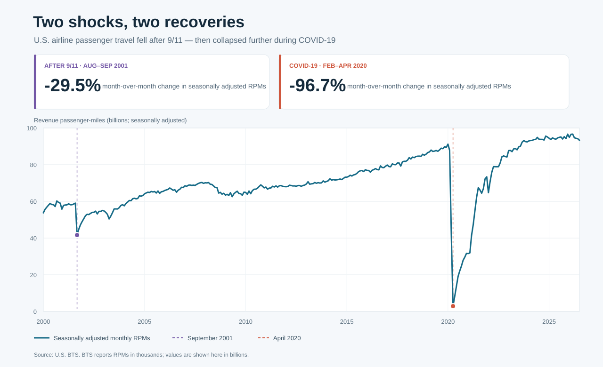

# Two shocks, two recoveries: U.S. airline passenger travel



*Figure 1. Monthly U.S. airline revenue passenger-miles. Dashed lines mark the
two disruption points; percentages show the change from the comparison month.*

## Executive summary

- The monthly seasonally adjusted series fell **29.5%** from August to September
  2001, immediately after the September 11 attacks.
- It fell **96.7%** from February to April 2020 during the COVID-19 pandemic:
  a much deeper drop than the September 2001 decline.
- By July 2026, the latest complete observation in the downloaded data,
  passenger-miles had recovered to **93.3 billion**, above February 2020's
  **87.8 billion**.
- These figures describe changes in the series; they do not isolate either
  event's causal effect from other changes in travel demand and airline
  operations.

## The story behind the data

Air travel is a useful way to see how quickly a major shock can interrupt
economic activity. Revenue passenger-miles (RPMs) combine the number of
passengers carried with the distance they travel: one passenger carried for one
mile counts as one passenger-mile. The BTS series covers U.S. air carriers'
domestic and international scheduled passenger flights.

The first disruption is visible around September 2001. The seasonally adjusted
series fell from about **59.0 billion RPMs in August** to **41.6 billion in
September**. The second shock was more abrupt: the series declined from **87.8
billion in February 2020** to **2.9 billion in April**. Subsequent months show a
gradual recovery from that extraordinary low, followed by a return above its
February 2020 level.

Seasonal adjustment helps make month-to-month comparisons more meaningful by
accounting for recurring calendar and seasonal patterns. The chart therefore
uses BTS's seasonally adjusted total series (`rpm_d11`), rather than comparing
unadjusted months whose values may differ because of normal seasonal travel.

## Reading the visualization

- The line shows monthly, seasonally adjusted RPMs for domestic and
  international scheduled flights combined.
- The vertical axis is in **billions of passenger-miles**. BTS publishes this
  measure in thousands; the plotted values convert those observations to
  billions.
- Dashed markers identify September 2001 and April 2020. The headline
  comparisons use August-to-September 2001 and February-to-April 2020.
- Percent changes are calculated from the seasonally adjusted observations in
  those months: `(later month / earlier month - 1) × 100`.

## Interpretation and limitations

The two events have different shapes in this monthly series. In September 2001,
the initial month-to-month decline was substantial, but not comparable in scale
to the near-cessation of passenger travel visible in April 2020. The later
rebound also took place over a longer period after the COVID-19 low.

These observations do **not** prove that either event alone caused the full
change. In particular, September 2001 is a monthly total, so it cannot show
which days within the month drove the decline. The chart also does not identify
the effects of policy responses, economic conditions, airline capacity, or
other concurrent changes. Its purpose is to show the timing and scale of
changes in recorded passenger travel.

## Data and reproducibility

The dataset is the U.S. Bureau of Transportation Statistics (BTS) *Transportation
Services Index and Seasonally-Adjusted Transportation Data* dataset. The script
downloads the latest records from the BTS public API, saves the selected source
observations as a CSV, and generates the SVG chart.

From the repository root:

```bash
python "3. ora/air_travel_visualization.py"
python -m unittest discover -s "3. ora" -p "test_*.py" -v
```

The chart and downloaded data are saved to `3. ora/air_travel_disruptions.svg`
and `3. ora/data/air_passenger_rpm.csv`. Running the script refreshes both from
the live source; results may change as BTS publishes new monthly observations.

## References

### Data and historical context

1. U.S. Bureau of Transportation Statistics (BTS). *Transportation Services
   Index and Seasonally-Adjusted Transportation Data*. Dataset and series
   definitions, including RPM and seasonally adjusted RPM units. Retrieved
   October 14, 2026.
   <https://data.bts.gov/Research-and-Statistics/Transportation-Services-Index-and-Seasonally-Adjus/bw6n-ddqk>
2. BTS Socrata API. Selected monthly fields: observation date (`obs_date`),
   total RPM (`rpm`), and seasonally adjusted total RPM (`rpm_d11`).
   <https://data.bts.gov/resource/bw6n-ddqk.json?$select=obs_date%2Crpm%2Crpm_d11&$order=obs_date>
3. Federal Aviation Administration. *A Brief History of the FAA*. Historical
   context for federal aviation operations.
   <https://www.faa.gov/about/history/brief_history>
4. Centers for Disease Control and Prevention. *CDC Museum COVID-19 Timeline*.
   Historical context for the COVID-19 public-health emergency.
   <https://www.cdc.gov/museum/timeline/covid19.html>
