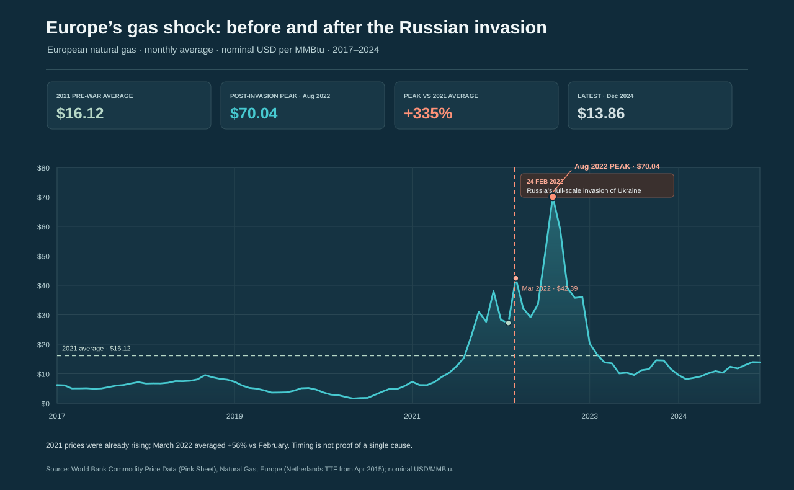

# Europe’s gas shock: prices before and after Russia’s invasion of Ukraine



*Figure 1. World Bank European natural gas reference price, in nominal US
dollars per million British thermal units. The February 2022 marker shows the
invasion date; the monthly averages show the surrounding price movement, not
the invasion’s isolated causal effect. The warm orange-and-amber palette
highlights the price surge against a dark, warm background.*

## Executive summary

- The World Bank’s European natural gas benchmark averaged **$16.12 per MMBtu
  in 2021**. Prices had already climbed during that year, from **$7.27 in
  January** to **$38.03 in December**.
- February 2022 averaged **$27.23 per MMBtu**. March, the first full month
  after Russia’s full-scale invasion began on 24 February, averaged **$42.39**,
  about **56% above February**.
- The monthly average peaked at **$70.04 in August 2022**, about **335% above
  the 2021 average**.
- By December 2024, the latest month in this historical workbook, the price
  had fallen to **$13.86 per MMBtu**.
- The spike followed the invasion and intensifying European supply concerns,
  but prices were already rising beforehand. This comparison shows timing and
  scale, not the share of the increase caused by the war alone.

## The story behind the data

Europe’s gas price was rising well before the invasion. The benchmark began
2021 at about **$7 per MMBtu** and ended the year above **$38**. That earlier
increase is important context: the market was already tight and volatile
before Russia launched its full-scale invasion of Ukraine.

The invasion began on **24 February 2022**. The February monthly average,
**$27.23**, includes days both before and after that date. March is therefore
the first full month after the invasion began. Its average rose to **$42.39**,
then prices climbed further through the summer. In **August 2022**, the
monthly average reached **$70.04**, more than four times the 2021 average.

That surge occurred as Europe faced major risks to Russian pipeline gas
supplies and raced to secure alternative supplies. Prices later declined as
market conditions changed, storage was replenished, and supply and demand
adjusted. The fall back by 2024 shows that this was a dramatic but not
permanent price plateau.

## Reading the visualization

- The line shows the **monthly European natural gas price**, in nominal US
  dollars per million British thermal units (**MMBtu**).
- The World Bank’s Europe series uses the **Netherlands Title Transfer
  Facility (TTF)** price from April 2015 onward.
- The vertical marker identifies **24 February 2022**, the start of Russia’s
  full-scale invasion. Monthly averages cannot separate the days before and
  after the invasion within February.
- The dashed horizontal line is the **2021 average**, a pre-invasion
  comparison point.
- The highlighted maximum is the highest **monthly average** in the
  post-invasion portion of this series, not the highest daily or intraday
  price.

## Interpretation and limitations

The European gas benchmark responds directly to supply expectations and is
more targeted to Europe’s exposure to disrupted Russian pipeline flows than a
global oil benchmark. Still, the chart does **not** estimate how much of the
price increase the invasion caused. Prices had climbed substantially through
2021; weather, storage levels, post-pandemic demand, LNG competition, pipeline
flows and policy responses also affected the market.

This is a Europe-wide benchmark, not the household tariff paid in each
country. Retail contracts and taxes vary, and consumer bills may adjust with a
delay. The values are nominal rather than adjusted for inflation.

The checked-in World Bank historical workbook was updated on **3 January
2025**, and its monthly series in this extract ends in **December 2024**. The
latest value here is therefore not a current 2026 quote. The plot is intended
to show the invasion-era shock and subsequent normalization, rather than
provide a live gas-price dashboard.

## Data and reproducibility

The series is *Natural Gas, Europe* from the World Bank’s *Commodity Price
Data (Pink Sheet)*. The World Bank identifies the Netherlands TTF as the
European gas reference price from April 2015. The local CSV contains the
monthly observations from January 2017 through December 2024 used in the
visualization.

From the repository root:

```bash
python "3. ora/gas_price_visualization.py"
python -m unittest discover -s "3. ora" -p "test_*.py" -v
```

The chart is saved to `3. ora/europe_gas_prices_ukraine_war.svg`. The script
reads the checked-in CSV and runs without network access.

## References

### Data and historical context

1. World Bank. *Commodity Price Data (The Pink Sheet)*, historical monthly
   workbook. Series: Natural Gas, Europe. The workbook identifies the Europe
   quote as Netherlands TTF from April 2015 and gives the unit as nominal
   US dollars per MMBtu. Updated 3 January 2025.
   <https://thedocs.worldbank.org/en/doc/5d903e848db1d1b83e0ec8f744e55570-0350012021/related/CMO-Historical-Data-Monthly.xlsx>
2. World Bank. *Commodity Markets*. Pink Sheet and commodity-market updates.
   <https://www.worldbank.org/en/research/commodity-markets>
3. U.S. Energy Information Administration. *Europe is a key destination for
   Russia’s energy exports*. Published 14 March 2022; context on Europe’s
   reliance on Russian gas and oil exports before the invasion.
   <https://www.eia.gov/todayinenergy/detail.php?id=51618>
4. United Nations. *UN General Assembly votes to suspend Russia from the Human
   Rights Council*. Background on the international response to the invasion.
   <https://news.un.org/en/story/2022/04/1115782>
