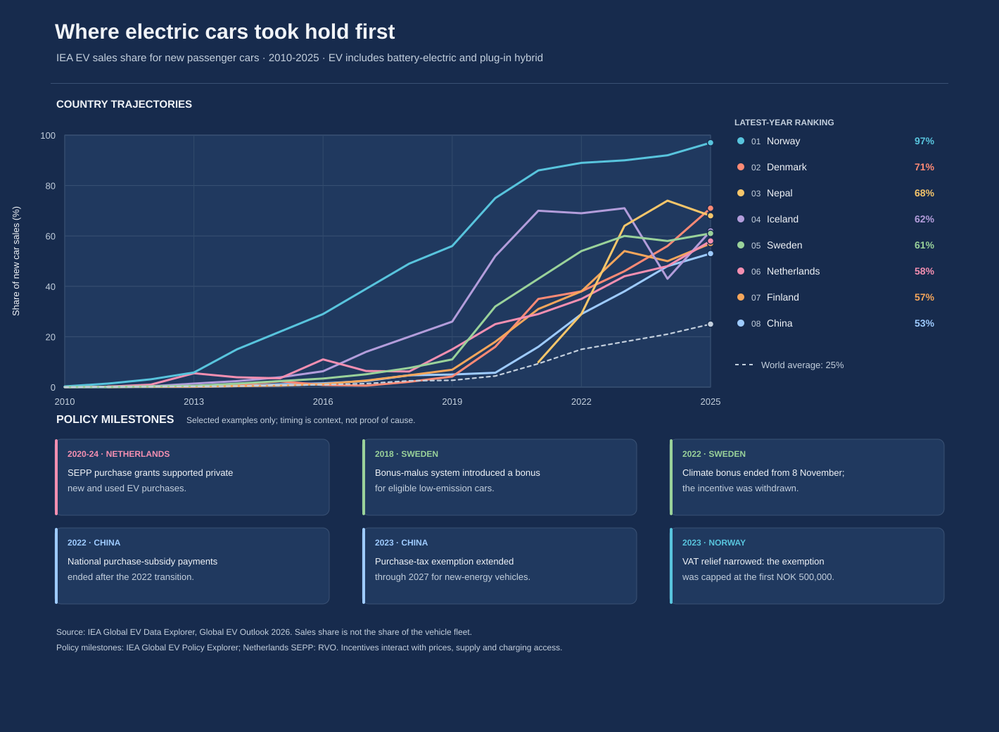

# Flat, policy shift, take-off? Three EV adoption stories



*Figure 1. The muted segment shows the selected pre-policy period. The dashed
line marks a 2020 policy change; the brighter segment shows the later trend.
The sequence is suggestive, not proof of causation.*

## Executive summary

- **Germany is a strong example of the pattern:** the EV share of new passenger
  car sales moved from **0.7% in 2015 to 3.0% in 2019**. After the federal
  purchase grant was doubled in 2020, the share reached **31% in 2022**—a
  **28-percentage-point** increase from 2019.
- In China, the share rose gradually from **4.7% in 2018 to 5.7% in 2020**.
  China extended purchase subsidies through 2022 that year; the share then
  reached **29% in 2022**.
- France followed a similar, if less dramatic, sequence: **2.7% in 2019**,
  followed by a larger purchase bonus in 2020 and **20% in 2022**.
- The close timing is worth investigating, but the chart cannot establish that
  subsidies alone caused these increases. All three policies overlapped with
  the pandemic-era market and economic changes.

## The story behind the data

This version asks a narrower question than a leaderboard: **where was the EV
sales share comparatively slow, what purchase support changed, and what
happened afterward?** It focuses on Germany, China and France because their
series show a relatively gradual pre-period followed by a large rise after a
notable 2020 incentive change.

Germany is the clearest illustration. Its new-car EV share stayed below 3%
through 2018 and was 3% in 2019. In 2020 Germany introduced the Innovation
Premium, doubling the federal portion of the environmental purchase bonus for
eligible cars. The share was **14% in 2020**, **26% in 2021**, and **31% in
2022**. The policy and subsequent acceleration line up in time, making Germany
a reasonable example to explore—not proof that the bonus explains the whole
rise.

China's series was also modest through 2020: 4.7% in 2018, 5.0% in 2019 and
5.7% in 2020. In April 2020, the government extended purchase subsidies through
2022. China's EV sales share rose to 16% in 2021 and 29% in 2022. This is a
similar sequence, though supply, model availability, charging, and other
industrial policies also matter.

France provides another useful comparison. Its share was 2.7% in 2019, then
rose to 11% in 2020 and 20% in 2022. As part of its 2020 recovery measures,
France increased its purchase bonus for eligible electric cars. The annual
series cannot tell us which months the change affected, or separate this bonus
from the broader forces behind the common 2020–22 acceleration.

## Reading the visualization

- Each row uses the same **0–60%** vertical scale and the same year axis.
- The gray line and lightly shaded band highlight the selected pre-policy
  period. The dashed vertical marker identifies the **2020 policy change**.
  The country-colored line shows the later trajectory.
- **pp** means percentage points. For Germany, the highlighted post-period
  change is from 3% in 2019 to 31% in 2022: **+28 percentage points** (not a
  28% relative increase).
- Each point is the annual EV share of new passenger-car sales. EV includes
  battery-electric and plug-in hybrid cars in the IEA series.
- These are selected case studies, not an automatic ranking of which country
  had the most effective policy.

## Interpretation and limitations

The chart makes policy timing and adoption changes easy to compare, but does
not estimate a causal effect. A rising line after a policy is consistent with
the policy helping; it does not tell us how much adoption would have risen
without it. In particular, all three examples involve policies around 2020,
when the pandemic, stimulus programs, vehicle supply, prices and consumer
preferences were also changing.

The policy announcement and the adoption data are annual, while policy changes
often took effect partway through a year. A marked 2020 change should therefore
be read as a year-level comparison, not a precise before/after experiment. The
sales-share measure also describes new-car purchases, not the share of the
vehicle fleet that is electric or total vehicles sold.

## Data and reproducibility

The country series comes from the IEA's *Global EV Data Explorer*, published
with the 2026 *Global EV Outlook*. The local CSV is a filtered snapshot of the
publicly shared IEA-derived 2026 historical sales-share data. It covers
passenger cars through 2025 and is stored with source and attribution details
in its header.

From the repository root:

```bash
python "3. ora/global_ev_adoption.py"
python -m unittest discover -s "3. ora" -p "test_*.py" -v
```

The chart is saved to `3. ora/global_ev_adoption.svg`. The script reads the
checked-in CSV and needs no network access.

## References

### EV adoption data

1. International Energy Agency (IEA). *Global EV Outlook 2026: Global EV data*.
   <https://www.iea.org/data-and-statistics/data-product/global-ev-outlook-2026#global-ev-data>
2. IEA. *Global EV Data Explorer*. Historical country sales-share series and
   data definitions. <https://www.iea.org/data-and-statistics/data-tools/global-ev-data-explorer>
3. Environment Dashboard. *Electric share of new vehicle sales*. CC BY 4.0
   derived series used as the snapshot intermediary.
   <https://environmentdashboard.org/data/ev/iea/sales-share>

### Policy context

4. German Federal Office for Economic Affairs and Export Control (BAFA).
   *Environmental Bonus (Umweltbonus)*. Program information and grant rules.
   <https://www.bafa.de/DE/Energie/Energieeffizienz/Elektromobilitaet/Umweltbonus/umweltbonus_node.html>
5. IEA. *Global EV Policy Explorer*. Country policy records for Germany, China
   and France. <https://www.iea.org/policies>
6. French Ministry for the Ecological Transition. *Electric-vehicle purchase
   bonus*. <https://www.ecologie.gouv.fr/politiques-publiques/bonus-ecologique>
