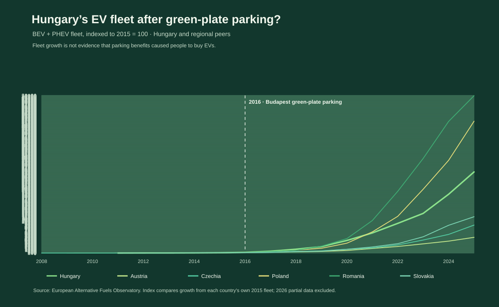

# Did free green-plate parking encourage Hungarians to buy electric cars?



*Figure 1. Battery-electric and plug-in hybrid vehicle fleet counts indexed to
2015 = 100. The policy marker is local to Budapest; it is not a national
treatment date.*

## Executive summary

- Hungary's reported BEV-plus-PHEV fleet rose from **443 vehicles in 2015** to
  **114,234 in 2025**, about **258 times** its 2015 size.
- The 2025 Hungarian total comprises **101,167 BEVs** and **13,067 PHEVs**.
- The measured fleet also grew substantially in neighbouring countries. From
  2015 to 2025, the combined fleet rose about **50 times in Austria**, **89
  times in Czechia**, **419 times in Poland**, **500 times in Romania**, and
  **116 times in Slovakia**. The large multiples partly reflect very small
  starting fleets.
- The data show that Hungary's EV fleet expanded during the period when
  green-plate parking incentives existed. They **cannot show that free parking
  motivated buyers**, or estimate how much adoption it caused.

## The story behind the data

Hungary's green registration plates have been associated with local parking
benefits. Budapest is often used as the reference case, but parking rules are
set locally: eligibility and phase-out dates are not uniform across Hungary.
The European Alternative Fuels Observatory (EAFO) describes free parking as a
local incentive and notes that Budapest and other cities are changing or
phasing out the benefit. The chart marks 2016 as an approximate Budapest
policy-period marker, not as a nationwide policy start date or proof that
every Hungarian EV owner received the benefit.

To put the trend in context, the chart compares Hungary's annual BEV-plus-PHEV
fleet with five neighbouring EU countries. Each country's series is indexed to
its own 2015 value. Hungary's fleet was 443 in 2015 and 1,014 in 2016, a
128.9% increase in that first year; the corresponding first-year increases
were 68.5% in Austria, 43.0% in Czechia, 57.8% in Poland, 98.8% in Romania, and
22.1% in Slovakia. This is a descriptive comparison, not a controlled
experiment. In particular, the unusually large growth multiples can result
from tiny initial counts.

The dataset records vehicles in the fleet, not individual purchase decisions
or reasons for buying. It does not identify which vehicles were parked in
Budapest, whether an owner used the exemption, or whether a parking benefit
changed the purchase decision. National vehicle counts also include people who
were not exposed to the Budapest policy. Other incentives, prices, charging
infrastructure, income, and vehicle availability changed over the same period.

## Reading the visualization

- The vertical axis is an index: each country's reported BEV-plus-PHEV count in
  2015 equals 100. A value of 1,000 means ten times that country's 2015 fleet.
- Lines show annual passenger-car and van fleet counts for BEVs and PHEVs
  combined in Hungary, Austria, Czechia, Poland, Romania, and Slovakia.
- The dashed 2016 marker is contextual and refers to the approximate start of
  the Budapest policy period. The chart does not imply that all of Hungary was
  treated by the same rule.
- The comparison uses 2015 as its base year because it precedes the marked
  policy period and has positive reported BEV-plus-PHEV counts in all six
  countries.

## Interpretation and limitations

Hungary's reported electric fleet grew rapidly after the 2015 baseline, but so
did fleets in the neighbouring countries. The timing is consistent with free
parking having been one possible incentive, but it does not establish that
parking caused the increase or quantify how many purchases it prompted.

The parking benefit is local, while this dataset is national. In addition,
green-plate eligibility and local parking rules have changed. The comparison
keeps BEVs and PHEVs together across all years for a consistent fleet measure;
it should not be read as a count of vehicles eligible for free parking under
every year's rules.

A stronger causal study would need data at the municipality or buyer level:
for example, EV registrations by residence over time, the dates and terms of
each municipality's parking rules, and comparable places without the benefit.
Buyer surveys or parking-permit records could help determine whether the
benefit affected individual decisions.

## Data and reproducibility

The dataset contains **2,916 country-year-fuel observations**: 27 EU member
states, 18 years (2008–2025), and six alternative-fuel categories (BEV, PHEV,
hydrogen, LPG, CNG, and LNG). It is a tidy, long-format panel compiled from
the EAFO country pages. Blank values are left blank when the source provides no
count; they are not converted to zero. The incomplete 2026 observations are
excluded so every country is compared through the latest complete year.

The script fetches the current country CSV links from EAFO, saves the compiled
dataset, and regenerates the chart:

```bash
python "3. ora/green_plate_parking.py"
python -m unittest discover -s "3. ora" -p "test_*.py" -v
```

Generated files:

- `3. ora/data/eu_alternative_fuel_vehicle_fleet.csv`
- `3. ora/green_plate_parking.svg`

## References

1. European Alternative Fuels Observatory. *Hungary: Vehicles (registrations
   and fleet)*. Country profile and downloadable annual vehicle-fleet data.
   <https://alternative-fuels-observatory.ec.europa.eu/transport-mode/road/hungary>
2. European Alternative Fuels Observatory. *Hungary: Incentives and
   legislations*. Local-incentive context and update dated 18 April 2025.
   <https://alternative-fuels-observatory.ec.europa.eu/transport-mode/road/hungary/incentives-legislations>
3. Villanyautósok. *Mely városokban lehet zöld rendszámmal ingyen parkolni?*
   (Which cities allow free parking with a green plate?). Describes the
   municipality-by-municipality nature of the benefit and its changing
   availability. <https://villanyautosok.hu/zold-rendszam/mely-varosokban-lehet-zold-rendszammal-ingyen-parkolni/>
