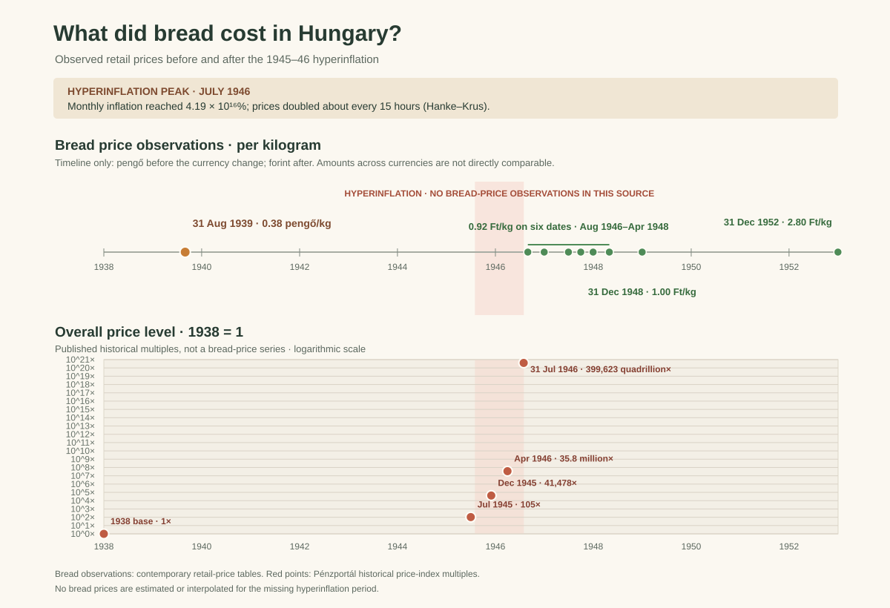

# What did bread cost in Hungary during hyperinflation?



*Figure 1. Bread prices are shown only for dates where a historical retail-price
table reports an observation. A separate panel shows the general price level
relative to 1938 during hyperinflation; it is not a bread-price series.*

## Executive summary

- The archived Hungarian retail-price table reports **0.38 pengő per kilogram
  of bread** on 31 August 1939.
- It reports **0.92 forint per kilogram** on six dates from 31 August 1946 to
  30 April 1948, followed by **1.00 forint** on 31 December 1948 and **2.80
  forint** on 31 December 1952.
- The source does not give a comparable retail bread price for the period of
  peak hyperinflation in 1945–46. The chart leaves that gap visible instead
  of inventing daily bread prices or comparing pengő and forint amounts as if
  they were the same currency.
- As context, a separate historical price-level table reports that prices
  rose from **105 times the 1938 level in July 1945** to **399,623 quadrillion
  times that level by 31 July 1946**. This is a general price-level measure,
  not the price of bread.

## The story behind the data

Hungary's post-war hyperinflation ran from August 1945 through July 1946. At
its peak in July 1946, Hanke and Krus report that monthly inflation reached
**4.19 × 10¹⁶%**, with prices doubling in roughly 15 hours. Hungary introduced
the forint on 1 August 1946, replacing the pengő after its value had collapsed.

It is natural to ask how much a basic food such as bread cost during this
period. The historical retail-price table located for this analysis does not
provide a continuous 1945–46 bread-price series. Its bread observations begin
with a pre-war price in pengő and resume in forint at the end of the
hyperinflation. The forint was a new currency, so its nominal prices cannot be
plotted on the same numeric scale as pengő prices without a clear conversion
and price-level definition.

The chart therefore separates two kinds of evidence:

1. A **timeline of the actual bread-price observations** in contemporary
   retail-price tables, with each currency identified.
2. A **general price-level series** during 1945–46, shown separately on a
   logarithmic axis to make the inflation episode visible without presenting
   it as a bread price.

## Reading the visualization

- The upper timeline shows recorded prices per kilogram, not a continuous
  daily or monthly series. Dots mark only the source dates.
- Pengő applies to the August 1939 observation; forint applies to all listed
  observations from August 1946 onward. Those amounts are not directly
  comparable across the currency reform.
- The shaded band marks the August 1945–July 1946 hyperinflation period. There
  are no bread-price observations from the cited retail table within that
  interval.
- The lower chart shows the reported **overall price-level multiple relative
  to 1938 = 1**, on a logarithmic scale. It is not the consumer price of
  bread, and the points are not interpolated.
- Separately, the banner reports the Hanke–Krus peak monthly inflation rate.
  That percentage is a rate, not a price-level multiple.

## Interpretation and limitations

The chart supports a careful but limited conclusion: available retail-price
tables document bread prices before and after the peak, while a separate
historical price-level series documents the extraordinary inflation in
between. These sources do not establish the exact retail price paid for bread
on every day or month of the crisis.

The two source tables are historical compilations with different reporting
dates and currencies. The retail-price table’s dates are snapshots; they
should not be read as a complete price series. The general price-level
multiples come from a secondary historical summary and do not identify the
price change of bread in particular. Currency redenomination, price controls,
shortages, and differences between official and market prices complicate
nominal comparisons.

A better continuous bread-price reconstruction would require contemporaneous
Budapest market-price bulletins or newspaper price quotations with consistent
dates, product definitions, and currency units. The plotted points should be
extended only if those source records can be verified.

## Data and reproducibility

The project contains two small, source-backed CSV files:

- `data/hungary_bread_prices.csv`: nine observed bread prices, with date,
  amount per kilogram, currency, and source note.
- `data/hungary_price_level_1938_base.csv`: the 1938 reference base and four
  reported general price-level multiples used to show the scale of hyperinflation.

The script reads both CSV files and generates the SVG using Python’s standard
library:

```bash
python "3. ora/hungary_bread_prices.py"
python -m unittest discover -s "3. ora" -p "test_*.py" -v
```

## References

### Historical prices and inflation

1. Central Intelligence Agency. *Economic, Sociological Statistics on
   Hungary, 1937–1948*. “Principal Retail Prices, 1939, 1946–48,” p. 18.
   Archived scan of the contemporary report; reports bread prices per
   kilogram and labels pengő and forint columns separately.
   <https://archive.org/details/cia-readingroom-document-cia-rdp80-00809a000700190118-9>
2. Central Intelligence Agency. *Cost of Living in Hungary*. 1953. Retail
   prices per kilogram for bread: 0.38 pengő in 1938, 1.00 forint in 1948,
   and 2.80 forint in 1952.
   <https://archive.org/details/cia-readingroom-document-cia-rdp80-00809a000700160374-8>
3. Garami, Erika. “A hiperinfláció számokban” (“Hyperinflation in numbers”).
   *Pénzportál*, 1 November 2006; archived 21 July 2011. Source for the
   reported historical price-level multiples relative to 1938.
   <https://web.archive.org/web/20110721085706/http://www.penzportal.hu/index.cgi?r=&v=&l=&feaz=75a8wc4sitder9&mf=&p=12732>
4. Hanke, Steve H., and Nicholas Krus. *World Hyperinflations*. Cato
   Institute. Source for Hungary’s July 1946 peak monthly inflation rate and
   price-doubling estimate.
   <https://www.cato.org/working-paper/world-hyperinflations>
   <https://object.cato.org/sites/cato.org/files/pubs/pdf/hanke-krus-hyperinflation-table-may-2013.pdf>
5. Kumar, Vinitha. *The Hungarian Hyperinflation: A Look into the Production
   Side*. Johns Hopkins Institute for Applied Economics, 2015. Historical
   context on the August 1945–July 1946 episode.
   <https://sites.krieger.jhu.edu/iae/files/2017/04/Vinitha_Kumar_Hungary.pdf>
