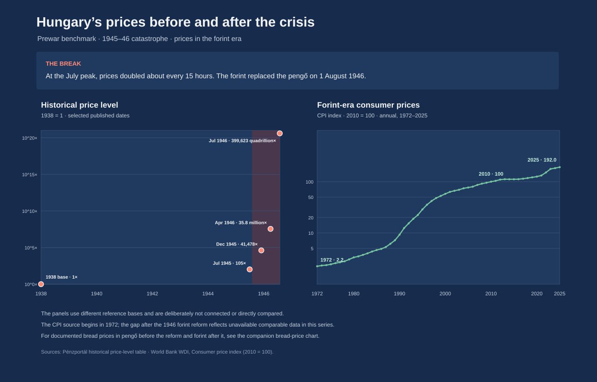

# Hungary’s 1946 hyperinflation: an index beyond the scale



*Figure 1. The published adópengő index observations rise from 1 on 1 January
to 2 × 10²¹ on 31 July 1946. The vertical axis is logarithmic. The Cato
Institute’s peak monthly price-inflation estimate is a separate measure.*

## Executive summary

- The adópengő index table records **eight dated observations** between
  **1 January and 31 July 1946**. It is not a complete daily dataset.
- The index rose from **1** on 1 January to **2 × 10²¹** on 31 July. A
  logarithmic scale is necessary to show both the early and late observations.
- Separately, the Hanke–Krus world hyperinflation table reports Hungary’s peak
  monthly inflation as **4.19 × 10¹⁶%** in July 1946, with prices doubling in
  about **15 hours**.
- These figures refer to different measures: the dated adópengő index and the
  monthly price-inflation rate should not be treated as the same series.

## The story behind the data

Hungary experienced an extreme hyperinflation in the final months of the
Second World War and its aftermath. The pengő’s purchasing power collapsed so
rapidly that the government introduced the adópengő on 1 January 1946 as an
indexed unit for accounting. The unit was later used for financial instruments
and currency. The forint replaced the pengő and adópengő on 1 August 1946.

The adópengő page publishes a compact table of its index: 1 on 1 January,
1.7 on 1 February, 10 on 1 March, 44 on 1 April, 630 on 1 May, 160,000 on
1 June, 7.5 billion on 1 July, and 2 sextillion on 31 July. The last month’s
increase is so large that a linear axis would make the earlier values appear
almost indistinguishable from zero.

The chart therefore uses a logarithmic vertical axis and plots only the eight
values actually listed in the source. The points are not expanded into a
fabricated daily series, and no values between the observations are
interpolated. For an independent measure of the episode’s peak, the
Hanke–Krus table reports a peak monthly inflation rate of 4.19 × 10¹⁶% in July
1946. That statistic describes monthly price inflation; it is not the index
plotted in Figure 1.

## Reading the visualization

- Each orange dot is one date/value pair from the cited adópengő index table.
- The vertical axis is logarithmic: equal vertical distances represent
  multiplication by the same factor, rather than equal additions.
- The last observation, 2 × 10²¹ on 31 July, is labelled directly.
- The peak monthly price-inflation estimate is shown above the plot as a
  separate statistic; it is not added as another point in the adópengő series.

## Interpretation and limitations

The chart makes the scale and acceleration of the index visible, but its eight
points cannot describe every day of the hyperinflation. In particular, the
long visual gaps between the dated observations do not imply that the index
changed smoothly or at a constant rate between those dates.

The adópengő was an indexed accounting unit that later circulated alongside
the pengő and, briefly, the forint. The forint replaced the pengő on 1 August
1946; the adópengő continued in circulation for a short period after that.
Its index is not interchangeable with a consumer price index or with the
monthly inflation-rate statistic in the Hanke–Krus table. The chart uses the
adópengő figures to show the scale of the episode; the monthly peak provides a
separately sourced measure of how quickly prices were changing.

## Data and reproducibility

The CSV contains the eight date/index pairs transcribed from the adópengő
table. The visualization uses Python’s standard library and produces an SVG
with a logarithmic vertical axis.

From the repository root:

```bash
python "3. ora/hungary_inflation_visualization.py"
python -m unittest discover -s "3. ora" -p "test_*.py" -v
```

The chart is saved to `3. ora/hungary_hyperinflation.svg`; the source values
are in `3. ora/data/hungary_adopengo_index.csv`.

## References

### Data and historical context

1. Hanke, Steve H., and Nicholas Krus. *World Hyperinflations*. Cato Institute,
   working paper and table of monthly inflation rates for 56 hyperinflations.
   Hungary’s peak monthly inflation and price-doubling estimate are reported
   for July 1946.
   <https://www.cato.org/working-paper/world-hyperinflations>
   <https://object.cato.org/sites/cato.org/files/pubs/pdf/hanke-krus-hyperinflation-table-may-2013.pdf>
   <https://www.cato.org/sites/cato.org/files/pubs/pdf/workingpaper-8_1.pdf>
2. “Hungarian adópengő.” *Wikipedia*. “Adópengő index, 1946” table; the article
   cites the Stanford working paper and Pénzportál source for the historical
   index.
   <https://en.wikipedia.org/wiki/Hungarian_ad%C3%B3peng%C5%91>
3. “History of the Hungarian Hyperinflation.” Stanford Institute for Economic
   Policy Research working paper, archived copy.
   <https://web.archive.org/web/20100718013923/http://www-siepr.stanford.edu/papers/pdf/00-01.pdf>
4. Garami, Erika. “Hyperinflation in Numbers.” *Pénzportál*, 1 November 2006,
   archived 21 July 2011.
   <https://web.archive.org/web/20110721085706/http://www.penzportal.hu/index.cgi?r=&v=&l=&feaz=75a8wc4sitder9&mf=&p=12732>
5. Kumar, Vinitha. *Hungary: Hyperinflation in Numbers*. Johns Hopkins
   Institute for Applied Economics.
   <https://sites.krieger.jhu.edu/iae/files/2017/04/Vinitha_Kumar_Hungary.pdf>
