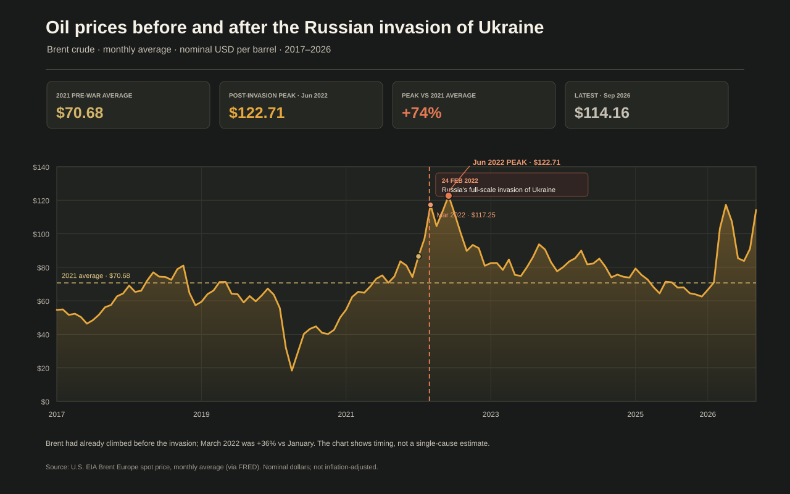

# The 2022 oil shock: Brent before and after Russia's invasion of Ukraine



*Figure 1. Europe Brent spot price in nominal US dollars per barrel. The
February 2022 marker shows when the invasion began; monthly averages show how
prices changed around that point, not the invasion's isolated causal effect.*

## Executive summary

- Brent crude averaged **$70.68 per barrel in 2021**, before the invasion.
  Prices were already rising: January 2022 averaged **$86.51**.
- February 2022 averaged **$97.13**. March, the first full month after the
  invasion began on 24 February, averaged **$117.25**—about **36% above January**.
- The highest monthly average in the series was **$122.71 in June 2022**, about
  **74% above the 2021 average**.
- Prices later fell back from that peak but remained volatile. The latest
  observation in this snapshot, **September 2026**, averaged **$114.16**.
- The timing and size of the 2022 jump are consistent with a major market
  reaction to the war and supply risks. They do not establish that the war
  alone caused the entire increase.

## The story behind the data

Oil prices were climbing before Russia's full-scale invasion of Ukraine.
Brent's monthly average rose from **$54.77 in January 2021** to **$74.17 in
December**, then reached **$86.51 in January 2022**. So the chart does not show
a flat oil market suddenly changing on the day the invasion began: a recovery
and tightening market were already under way.

The invasion began on 24 February 2022. February's average includes prices
from both before and after that date, so **March is the first complete
post-invasion month** in this monthly series. Brent averaged **$117.25 in
March** and reached its monthly-average peak of **$122.71 in June 2022**. Those
values make the post-invasion jump visible against the 2021 average benchmark.

The line then falls from the 2022 high, with later rises and declines. This
pattern matters: the invasion was a major supply-risk shock, but crude prices
continued to respond to global demand, producer decisions, inventories,
sanctions, shipping and other geopolitical developments. The International
Energy Agency's October 2026 *Oil Market Report* provides current market
context on those supply-and-demand forces; the chart itself uses the EIA Brent
price series.

## Reading the visualization

- The line shows the **monthly average Europe Brent spot price**, in nominal
  US dollars per barrel.
- The vertical marker identifies **24 February 2022**, the start of Russia's
  full-scale invasion of Ukraine. The monthly point for February averages the
  whole month; March is the first full month after the invasion began.
- The dashed horizontal line is the **2021 annual average**, a pre-invasion
  reference point.
- The highlighted 2022 peak is a **monthly average**, not the highest daily
  price. The January-to-March comparison uses January 2022 and March 2022
  monthly averages.
- The latest value is the latest complete monthly observation in the checked-in
  source snapshot.

## Interpretation and limitations

The chart shows what happened to a widely used international oil-price
benchmark around a major geopolitical event. It does **not** estimate how much
of the increase was caused by the invasion. Prices had already risen in 2021
and January 2022; the war coincided with concerns about Russian supply,
sanctions and trade disruptions, while demand recovery and producer decisions
also affected the market.

Monthly averages smooth out sharp daily movements and blend together days
before and after 24 February. Brent is a benchmark price, not the price paid by
every refinery, country or consumer. Values are nominal, not adjusted for
inflation, and changes in crude prices do not translate one-for-one into
retail fuel prices.

The IEA October 2026 report is cited for current oil-market context, not as the
source of the plotted historical prices. The chart uses the monthly Brent
series published by the U.S. Energy Information Administration and distributed
through FRED.

## Data and reproducibility

The plotted series is the U.S. Energy Information Administration's (EIA)
Europe Brent spot price, monthly average (`MCOILBRENTEU`), retrieved through
the Federal Reserve Bank of St. Louis FRED. The local CSV contains the
observations from January 2017 through September 2026 used to generate the
chart.

From the repository root:

```bash
python "3. ora/oil_price_visualization.py"
python -m unittest discover -s "3. ora" -p "test_*.py" -v
```

The chart is saved to `3. ora/brent_oil_prices_ukraine_war.svg`. The script
reads the checked-in CSV and runs without network access.

## References

### Oil prices and market context

1. U.S. Energy Information Administration (EIA). *Europe Brent Spot Price
   FOB, Monthly* (series RBRTE); source of the monthly Brent benchmark.
   <https://www.eia.gov/dnav/pet/hist/LeafHandler.ashx?n=PET&s=RBRTE&f=M>
2. Federal Reserve Bank of St. Louis, FRED. *Crude Oil Prices: Brent - Europe*
   (series `MCOILBRENTEU`), monthly observations sourced from EIA.
   <https://fred.stlouisfed.org/series/MCOILBRENTEU>
3. International Energy Agency (IEA). *Oil Market Report — October 2026*.
   Current oil-market supply, demand and price context.
   <https://www.iea.org/reports/oil-market-report-october-2026>
4. U.S. Energy Information Administration. *Europe is a key destination for
   Russia's energy exports*. Published 14 March 2022; context on Russia's role
   in international oil and energy trade.
   <https://www.eia.gov/todayinenergy/detail.php?id=51618>
5. United Nations. *UN General Assembly votes to suspend Russia from the Human
   Rights Council*. Background on the international response to the invasion.
   <https://news.un.org/en/story/2022/04/1115782>
