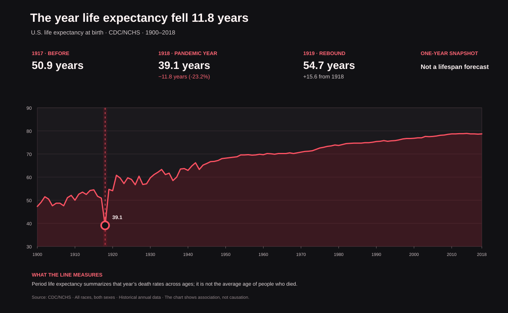

# The year life expectancy fell 11.8 years: the 1918 influenza shock



*Figure 1. CDC/NCHS annual U.S. life expectancy at birth, all races and both
sexes. The dark-red marker emphasizes the one-year trough in 1918.*

## Executive summary

- U.S. life expectancy at birth fell from **50.9 years in 1917** to **39.1
  years in 1918**: a drop of **11.8 years**, or about **23%**.
- In 1919, it rebounded to **54.7 years**—a one-year increase of **15.6
  years**, putting the measure **3.8 years above** its 1917 level.
- The sharp one-year canyon coincides with the 1918 influenza pandemic. It is
  a striking annual population-level signal, not evidence that every
  individual’s lifespan changed by 11.8 years.
- The CDC/NCHS series used here covers **1900–2018**. It does not provide a
  consistent annual U.S. series back to 1850.

## The story behind the data

Across the twentieth century, U.S. life expectancy generally rose as survival
improved. The long-run upward slope is interrupted by an unusually deep,
brief trough in 1918. In the CDC/NCHS series, the measure drops from **50.9**
years in 1917 to **39.1** in 1918, then returns to **54.7** in 1919.

That timing aligns with the 1918 influenza pandemic, which caused exceptionally
high mortality. The immediate rebound is part of the story: the chart shows
how a single year of elevated death rates can pull down period life expectancy,
even though the measure rises again when mortality rates change the following
year.

The chart follows the full available CDC/NCHS annual series rather than
starting at 1850, because the cited historical data begin in 1900. This keeps
the visualization anchored to one source series and makes the limits of the
historical comparison explicit.

## Reading the visualization

- The line shows **period life expectancy at birth**, in years, for the United
  States, all races, both sexes.
- The red vertical band identifies **1918**. The values above the chart compare
  1917, 1918 and 1919 directly.
- The plotted change is calculated from the source values: 1918 minus 1917 is
  **−11.8 years**; 1919 minus 1918 is **+15.6 years**.
- Period life expectancy summarizes the mortality rates observed across ages
  in one calendar year. It asks how long a hypothetical newborn would live if
  that year’s age-specific death rates persisted; it is not the average age of
  people who died that year.

## Interpretation and limitations

The timing and magnitude make the 1918 influenza pandemic an important context
for the trough, but this chart is descriptive, not a causal estimate. It
cannot separate influenza deaths from other causes of death or establish how
much of the annual change is attributable to any one cause.

Life expectancy is an aggregate measure, so a drop of 11.8 years does **not**
mean that each person lost 11.8 years of life. Annual data also conceal
within-year timing: the line cannot show when mortality rose or fell during
1918. The historical series starts in 1900, so it should not be presented as a
continuous 1850-to-present record.

## Data and reproducibility

The visualization uses CDC/NCHS's *Death Rates and Life Expectancy at Birth*
dataset. The script selects annual observations for **All Races** and **Both
Sexes**, saves the source values to CSV, and creates the SVG. The source
dataset currently ends at 2018 for these observations.

From the repository root:

```bash
python "3. ora/spanish_flu_visualization.py"
python -m unittest discover -s "3. ora" -p "test_*.py" -v
```

The script writes `3. ora/data/us_life_expectancy_1900_2018.csv` and
`3. ora/us_life_expectancy_1918_flu.svg`. Re-running it downloads the current
CDC dataset; historical values or availability may change if CDC updates its
release.

## References

### Data and historical context

1. National Center for Health Statistics (NCHS). *Death Rates and Life
   Expectancy at Birth*. CDC Open Data, NCHS/DVS. Historical U.S. mortality
   trends dataset; selected series: All Races, Both Sexes.
   <https://data.cdc.gov/d/w9j2-ggv5>
2. NCHS. *Death Rates and Life Expectancy at Birth* dataset download (CSV).
   <https://data.cdc.gov/api/views/w9j2-ggv5/rows.csv?accessType=DOWNLOAD>
3. Centers for Disease Control and Prevention. *Historical Data, 1900–1998*.
   Background and source collection for the historical mortality data.
   <https://www.cdc.gov/nchs/nvss/mortality_historical_data.htm>
4. CDC. *Mortality Trends in the United States*. Coverage and description of
   U.S. mortality and life-expectancy trends.
   <https://www.cdc.gov/nchs/data-visualization/mortality-trends/index.htm>
