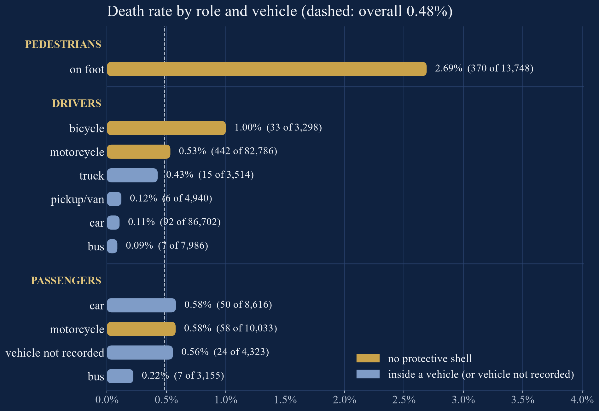
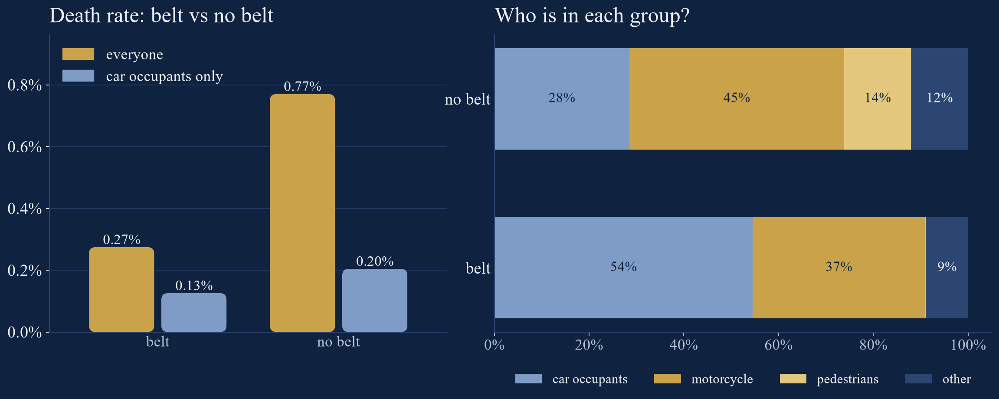
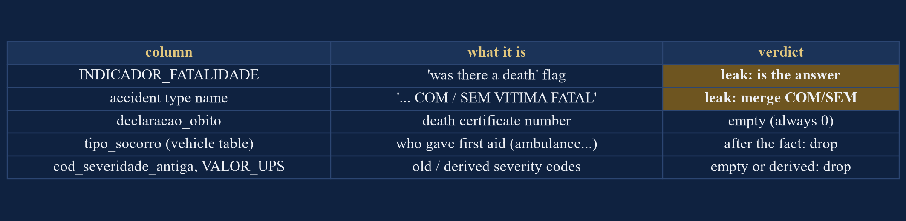
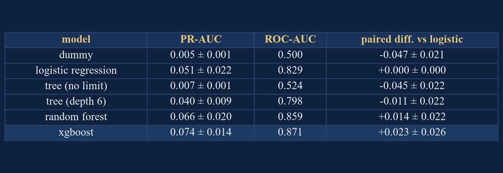
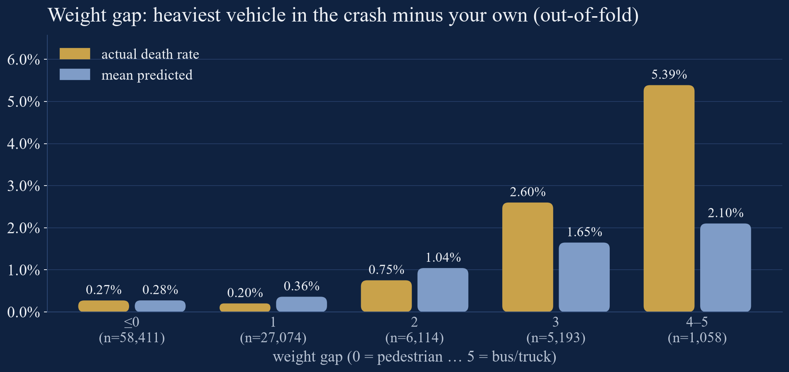
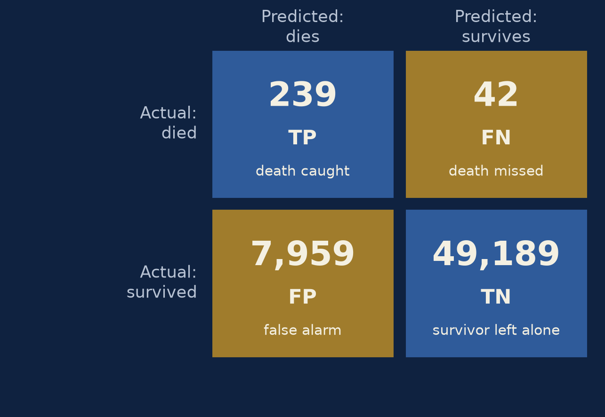
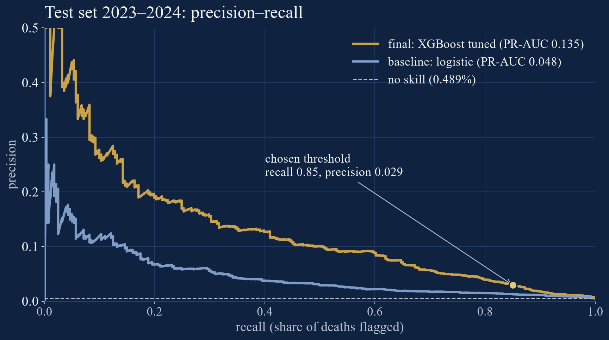
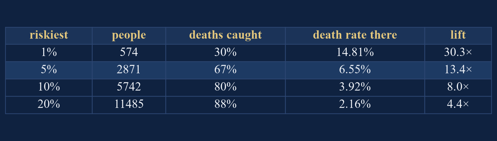

# Who dies in a crash? — Homework 4

**Márton Csepregi** · Data Science workshop, lesson 4 · full analysis: `homework_bh_crashes.ipynb`

## 1. Question and target

A crash is reported with everyone involved. For each person: **will they die?** The positive class is a death.
The use case is a trauma team deciding whom to treat first: a **missed death** costs far more than a **false alarm**
(an extra crew sent), so recall matters more than precision.

**Data.** I started from Kaggle's "Car Accident 2020", which claims to cover *all of Brazil*. It is in fact the 2020
**people** file of one city, **Belo Horizonte**. Its "death certificate" column, which the description calls the
target, is 0 in all but 2 of 240,257 rows. So I used the original open data (2016–2024, three linked tables:
accidents, people, vehicles): **230,978 people, 1,112 deaths (0.48%)**.

## 2. EDA

- A pedestrian dies in **2.7%** of cases, a car driver in **0.11%**. Between midnight and 5 am the rate is 4.9×
  the daytime rate; over 75 it is 1.7%.
- **Simpson's paradox:** without a seatbelt the death rate looks 2.8× higher, but "no belt" is 45% motorcyclists.
  Among car occupants the gap is only 1.6×.
- **A column changed meaning:** until 2021, 97% of motorcyclists "wore a seatbelt" (probably the helmet); from 2022, 2%.

## 3. Cleaning: three leaks

With every column, XGBoost reaches PR-AUC **0.877**; without the leaks, **0.074**. `INDICADOR_FATALIDADE` is
literally "was there a death", and the accident type *name* says "… COM / SEM VITIMA FATAL" (fatal / not fatal), so I
merged those two types into "pedestrian hit". The third leak was the hardest to spot: **pavement and weather** are filled
in mostly for serious crashes (**0.80% vs 0.16%** deaths, in 9 of 9 years). In my first model pavement was the 2nd most
important column, because it measures **how thorough the police report was**, not the road. Dropped.

**Missing values:** age 0 with no birth date → NaN; blank vehicle = pedestrian; median + flag for the linear model,
NaN for the trees. `sex = "not recorded"` (only 5% injured vs 55% overall) is a recording signal: kept as its own
category, flagged. **Encoding:** one-hot for 10 low-cardinality columns. The crash location (348 cells of 1 km) gets
a smoothed **target mean**, fitted inside each fold only.

## 4. Split first

**Train 2016–2022** (831 deaths), **test 2023–2024** (281 deaths), locked. The split is by time, because the model must
predict future crashes, and because the people in one accident must stay on the same side. It is a date rule, so there is
nothing to stratify; the models use seed 42. Cross-validation uses an **expanding window**: validate on 2019, 2020,
2021 and 2022, each time training only on the years before. Every model gets the **same four folds**.

## 5–6. Baseline models and metrics

The "nobody dies" model is **99.5% accurate** and finds no death. That is why I chose **PR-AUC**, balanced accuracy, the
confusion matrix and the riskiest 5% in advance, and not raw accuracy.

XGBoost minus logistic, paired by fold: **+0.023 ± 0.026**. That is smaller than its std, so on CV it is **a tie**.
At the 0.5 threshold XGBoost finds only 4 of 462 deaths. At the threshold of peak balanced accuracy (0.0035) it finds
380 (recall 0.82), with 22,977 false alarms. The riskiest 5% hold **46%** of the deaths (logistic: 37%).

## 7. Feedback loop

The most confidently missed deaths were drivers in crashes **with a bus or truck**. **Hypothesis:** the other vehicle
matters, and it is not in the person's row.

The error is real. At the largest weight gap (heaviest vehicle in the crash minus your own), the actual death rate is
**5.4%**, but the model predicts 2.1%. **New features:** `heaviest_vehicle`, `weight_gap` (a difference of two
columns), and `bus_or_truck_involved`. **Result, on the same folds:** XGBoost +0.007 ± 0.010, logistic
+0.003 ± 0.008. Both are **within the noise**: only 57 deaths in 2019–2022 have the largest gap. The gain is
**not proven**. I kept the features because they did not hurt. Unlike the lesson's price ratio, I found no
inverted-U shape here: age is a U shape, and both models already follow it.

## 8. Tuning

A random search over 10 XGBoost settings, scored on 2019–2020, then checked on 2021–2022, which the search never saw:
**0.083 → 0.088 (+0.006, the same in both folds)**. A simpler model won (fewer trees, slower learning rate).

## 9. The test set, once

The rule was fixed in advance: the best CV model (tuned XGBoost), and the threshold of peak balanced accuracy on the
training out-of-fold predictions (0.0054).

| 2023–2024 | Final XGBoost | Logistic baseline |
|---|---|---|
| deaths flagged (of 281) | **239** (recall 0.85) | 210 |
| false alarms | **7,959** | 12,356 |
| PR-AUC [95% bootstrap CI] | **0.135 [0.101; 0.174]** | 0.048 [0.035; 0.071] |
| deaths in the riskiest 5% | **67%** | 40% |

The paired difference is **+0.086 [0.055; 0.119]**. The bootstrap resamples **accidents**, not people. The test score
is above the CV estimate (0.088), but the interval is wide, so the CV number is the conservative one.
**Honesty note:** I looked at the test set twice. The first run flagged 73% of people in 2023. The cause was the 2023
vehicle file, which names its ID column `N§_boletim`, so those vehicles silently failed to join. I fixed the data;
the model and threshold rules did not change.

## 10. Limitations

1. **Few deaths:** with ~110 per validation year, XGBoost vs logistic and the new features are both within the noise.
2. **The recording drifts and follows the outcome** (seatbelt meaning, report completeness). I removed the clearest
   cases, but some recording signal surely remains.
3. **One city, police reports only.** Later hospital deaths may be missing, and nothing here is a causal claim.
