# What is this house worth next month? — Homework 5

**Márton Csepregi** · Data Science workshop, lesson 5 · extra detail: [`homework_appendix.md`](homework_appendix.md) ·
code: `pipeline.py` (final model), `final_test.py`

> **Result:** on the locked test (April–May 2015) the final model misses the price by **11.0% on average**
> (WAPE 0.110, RMSE 106.7k). A plain XGBoost misses by 13.0%, a fair linear model by 14.7%.
> Before the test, my validation had predicted 10.9%.

## 1. Question and target

**What will a house in King County (Seattle) sell for?** Imagine a price-estimate tool, for example a bank checking
how much a house is worth before lending on it. It is **retrained every month** and prices next month's houses. So the
question is also: how do we train it so it keeps working over time?

**Which error is worse?** For a bank, pricing a house **too high** is worse: it lends too much against it. And errors
matter **in proportion to the price**: 50k off on a 300k house is serious, on a 3M house it is small. So, chosen in
advance:
- **main metric: WAPE**, the share of the price we miss on average (Σ|error| ÷ Σ price);
- **bias** (total predicted ÷ total actual): below 1 means we price too low, above 1 too high. This is the one a bank
  watches;
- also RMSE, MAE and R².

Data: 21,613 sales from May 2014 to May 2015, no missing values.

## 2. EDA

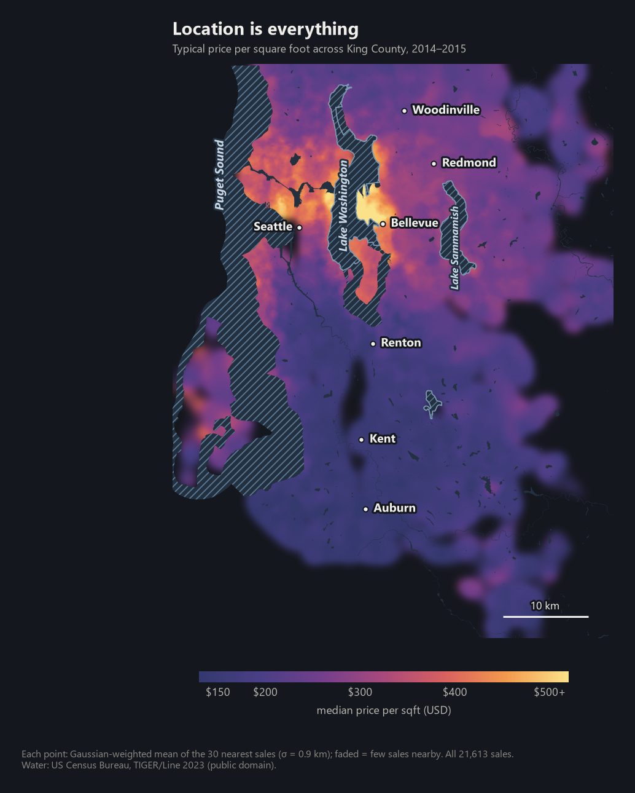

**Location is everything.** A square foot costs ~150 USD in the south and 500+ around Lake Washington and Bellevue.
The zipcode is just an ID, but it stands for a place, so I use it as a category, never as a number.

**Is it the water?** Partly. At the same distance from downtown Seattle, homes within 1 km of the Sound or the lakes
cost **15–30% more per sqft** in the 5–20 km ring, but **nothing extra** on the far southern shore. In the same
zipcode, for the same kind of house, a direct **waterfront** lot sells for about **+52%** per sqft (163 houses).
That is a link, not a cause: the lakeside towns are also the richest ones.

| Distance to the nearest large water | < 0.5 km | 0.5–1 | 1–2 | 2–4 | 4–8 | > 8 km |
|---|---|---|---|---|---|---|
| sales | 1,475 | 1,981 | 4,016 | 5,783 | 2,968 | 5,390 |
| median price per sqft (USD) | 330 | 303 | 281 | 270 | 235 | 177 |

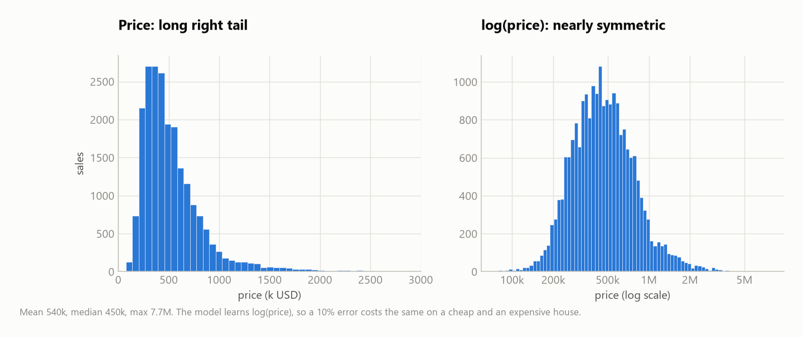

**The target is skewed** (mean 540k, median 450k, max 7.7M). On the log scale it is nearly symmetric, so the models
learn **log(price)**: then a 10% error costs the same on a cheap and an expensive house.

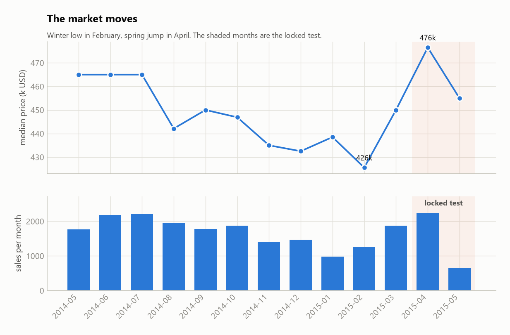

**The market moves.** Prices drop to 426k (median) in February and jump to 477k in April. So the model must be tested
on *later* months than it learned from, never on shuffled rows. With only 13 months, every calendar month appears once,
so **seasonality cannot be learned** from this data.

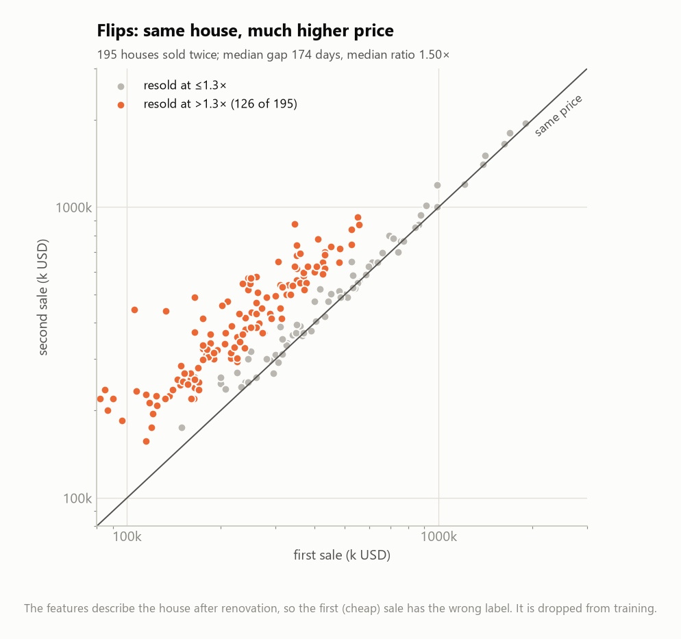

**Same house, different price.** 195 houses were sold twice, the second time at a median **1.5×** the first price,
~6 months later. Their features are identical at both sales: the data keeps one description per house, not one per
sale. Two consequences: the same house must never be in both the training and the test data, and the cheap first
sale of such a "flip" does not match its description (section 3).

## 3. Cleaning

| What | Why |
|---|---|
| 33 bedrooms → 3 | 1,620 sqft: 33 rooms would be 4.5 m² each. 69% of similar houses have 3, and its price is normal for its area, so it is a typo, not a dorm. Dropping the row would have been fine too: it is only ever a training row. |
| `yr_renovated = 0` → "never renovated" flag + years since the last work | 95.8% are 0, which means "never", not "in year 0" |
| zipcode as a category | 98001 is not "more" than 98000 |
| age = sale year − year built | what counts is the age at the sale |
| a house id from location, size and year built | to keep both sales of a house on the same side (the data has no id column) |

None of these use the price, so they are safe before the split.

**Which training rows to drop?** I tried 11 filters (appendix A). Three small ones help: the cheap first sale of a
flip, sales far too cheap for their zipcode, and houses "renovated" after they were sold. Together: **−1.30k ± 0.61k
RMSE, better in 5 of 5 folds**. Stronger filters (removing everything the model finds surprising) made it **worse**:
they throw away real luxury houses. I only filter the **training** data; every sale I test on stays, otherwise the
score would improve just because the hard cases were removed.

## 4. Split first

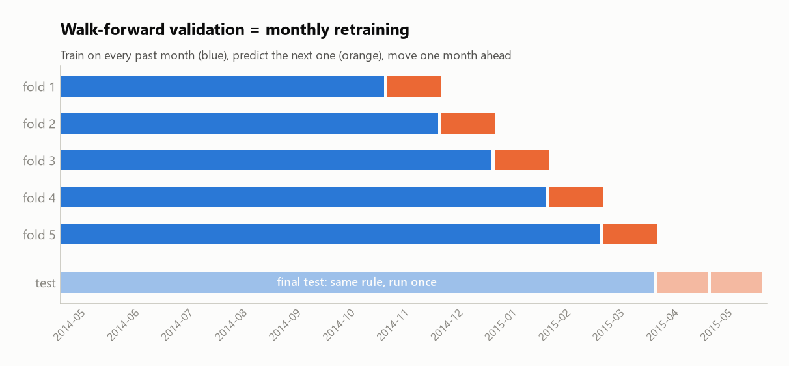

- **Locked test:** April – May 2015 (2,815 sales), split **by time**, because the model must predict the future. I
  touched it only once, at the very end. 62 test sales were houses already sold earlier; I removed them from the test,
  so no house is on both sides.
- **Validation (walk-forward):** train on all past months, predict the next month, then move one month ahead
  (5 times, Nov 2014 – Mar 2015). This is exactly what monthly retraining would do. Every model gets the same 5 folds.
  Everything that is fitted (scaling, zipcode medians, the conversion back from log) is fitted on the training part
  of each fold only.

## 5–6. Baselines and metrics

| Model (validation, mean of 5 folds) | WAPE | RMSE | MAE | R² | bias |
|---|---|---|---|---|---|
| mean price | 0.448 | 352k | 235k | 0.00 | 1.027 |
| zipcode median (naive rule) | 0.290 | 281k | 153k | 0.36 | 0.895 |
| linear (log price, zipcode dummies, log sizes) | 0.136 | 123k | 71k | 0.88 | 0.977 |
| decision tree (log price) | 0.170 | 173k | 90k | 0.76 | 0.977 |
| Random Forest (log price) | 0.133 | 133k | 70k | 0.86 | 0.962 |
| **XGBoost (log price)** | **0.117** | **109k** | **62k** | **0.90** | **0.971** |

- The linear model is set up **fairly** (log price, zipcode dummies), which is why it reaches 123k instead of the
  ~203k in the assignment's pre-measurement.
- **XGBoost is the best in all 5 folds**: −14k RMSE vs. linear, −24k vs. Random Forest, −65k vs. a single tree.
- **Converting back from log:** exp(predicted log) alone is too low on average, so I multiply by a correction factor
  learned from the training errors ("smearing"). Even so, XGBoost's bias is **0.971**: it prices 3% too low. Why?

## 7. How to retrain: the model lags the market

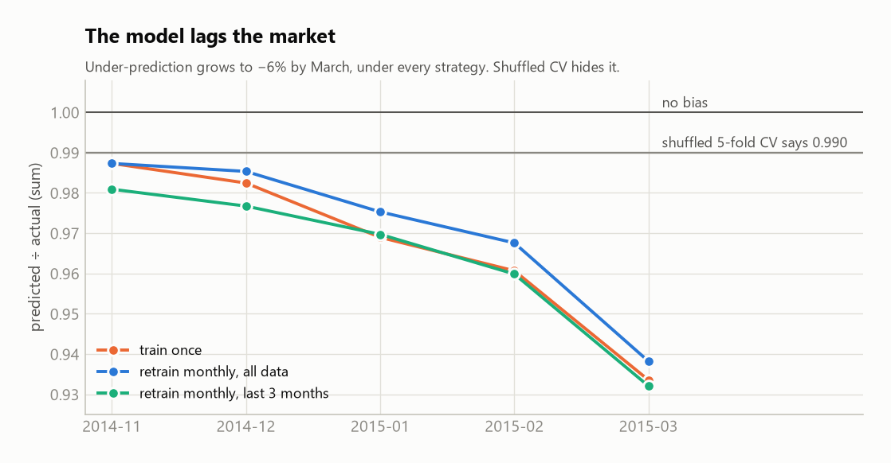

- **The model is always one step behind a rising market.** It learns from past prices, so by March it prices
  **6% too low**, whatever retraining strategy I use.
- **Shuffled validation hides this** (it shows a bias of 0.990), because it secretly lets the model see future prices.
- **Retrain monthly on all past data.** Never updating is worse (+3.1k ± 2.2k RMSE, and the gap grows every month).
  Keeping only the last 3 months is much worse (+18.7k ± 9.6k): here, more data beats fresher data (appendix B).
- **In production:** check the bias every month. Two months outside 0.97–1.03 means the market has moved.

## 8. Diagnostics

*On the validation predictions of the final model (6,870 sales, before the fix at the end of this section).*

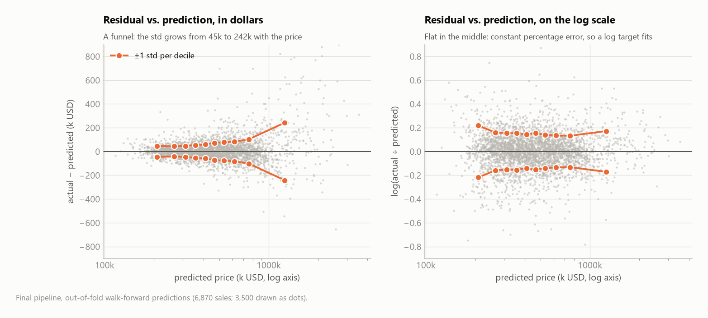

**Error vs. prediction.** *What I see:* in dollars the error grows with the price (a funnel, like slide 29: the spread
goes from 45k to 242k). In percent it stays flat. *What it means:* the model makes a constant *percentage* error, which
is exactly why it learns log(price). No change needed.

**Calibration by predicted price** (actual ÷ predicted, in 10 groups from cheapest to most expensive prediction):

| Predicted group | 1 | 2 | 3 | 4 | 5 | 6 | 7 | 8 | 9 | 10 |
|---|---|---|---|---|---|---|---|---|---|---|
| mean prediction | 209k | 265k | 311k | 357k | 410k | 467k | 533k | 619k | 756k | 1,253k |
| actual ÷ predicted | 1.023 | 1.013 | 1.010 | 1.010 | 1.011 | 1.006 | 1.016 | 1.010 | 1.007 | **1.037** |
| WAPE | 0.149 | 0.112 | 0.103 | 0.106 | 0.097 | 0.104 | 0.100 | 0.096 | 0.091 | 0.129 |

*What I see:* within 1–2% everywhere, but the most expensive tenth is **3.7% too low**, and both ends are harder.
*What I did:* see the fix below.

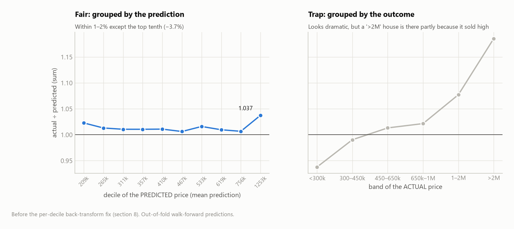

**A trap I almost fell into.** Grouped by the **actual** price (right), it looks dramatic: houses under 300k are 6% too
high, houses over 2M are 19% too low. But grouping by the outcome always looks like this. A house lands in the ">2M"
group partly *because* it got lucky and sold high, so the lucky sales collect at the top and the unlucky ones at the
bottom. Grouping by the **prediction** (left) is the fair test.

| Segment | n | actual ÷ predicted | WAPE | Reading |
|---|---|---|---|---|
| waterfront | 54 | **1.127** | 0.180 | rare luxury feature, priced too low |
| view = 4 (best view) | 98 | **1.083** | 0.172 | same |
| age 50–80 / 80+ | 1,848 / 867 | 1.028 / 1.027 | 0.129 / 0.139 | old houses: their state varies, the data can't see it |
| grade ≤ 6 | 758 | 1.030 | 0.171 | the cheapest, roughest houses are the hardest |
| worst zipcodes (98146, 98014, 98118) | 39–175 | 0.97–1.03 | 0.16–0.17 | no zipcode is systematically off |

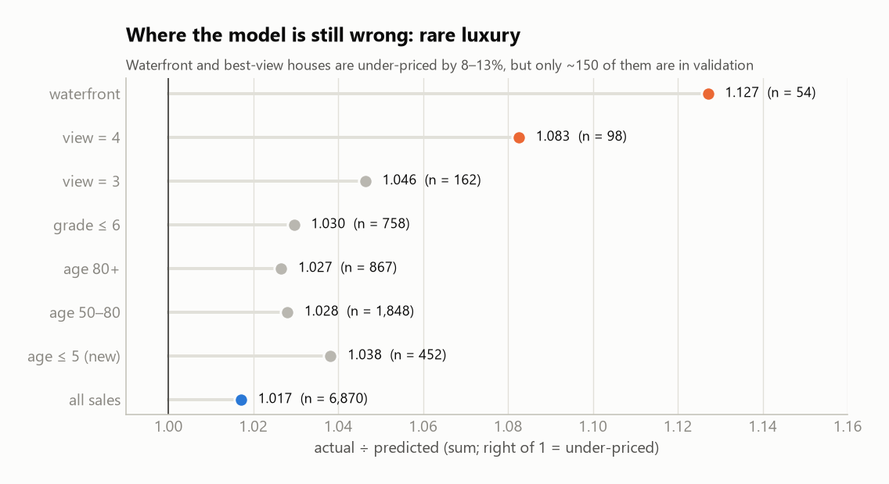

**Segments.** *What I see:* waterfront and best-view houses are 8–13% too cheap. *What I would do:* a feature for
"distance to the shore" might help, but with only ~150 such houses in validation, any gain would be impossible to
prove, so I left it as a known weakness.

**The map.** *What I see:* on a 12 × 12 grid, the average error per cell varies by only 2% (worst cells −6.6% and
+4.6%). *What it means:* no neighbourhood is left behind, so the "neighbours' error" correction (section 9) works.

**Impossible predictions.** *What I see:* none are negative or zero. 16 of 6,870 sales went for less than half the
prediction (e.g. 130k for a house predicted at 401k). *What I would do:* nothing; they look like non-market sales
(family transfers, foreclosures), and a real tool would meet them too, so they stay in the test.

**The fix.** The conversion back from log used one factor for every price, but the error is wider at the ends. So I
learn the factor **separately for each of the 10 price groups**:

| Conversion back from log | WAPE | RMSE | bias | Folds better (RMSE) |
|---|---|---|---|---|
| one factor for all | 0.1093 | 101.3k | 0.984 | – |
| **one factor per price group (kept)** | **0.1090** | **100.1k** | **0.993** | **4/5 (−1.23k ± 0.83k)** |

## 9. Feedback loop: features and corrections

**Hypothesis** (from the bias in section 7): the model misses the fresh, *local* price level.

**New feature: "comps"**, what an appraiser does: the average price per sqft of the nearest sales, times the size of
the house. Computed **inside each fold from the training sales only**, and never counting the house itself or its
other sale, so it cannot leak the answer.

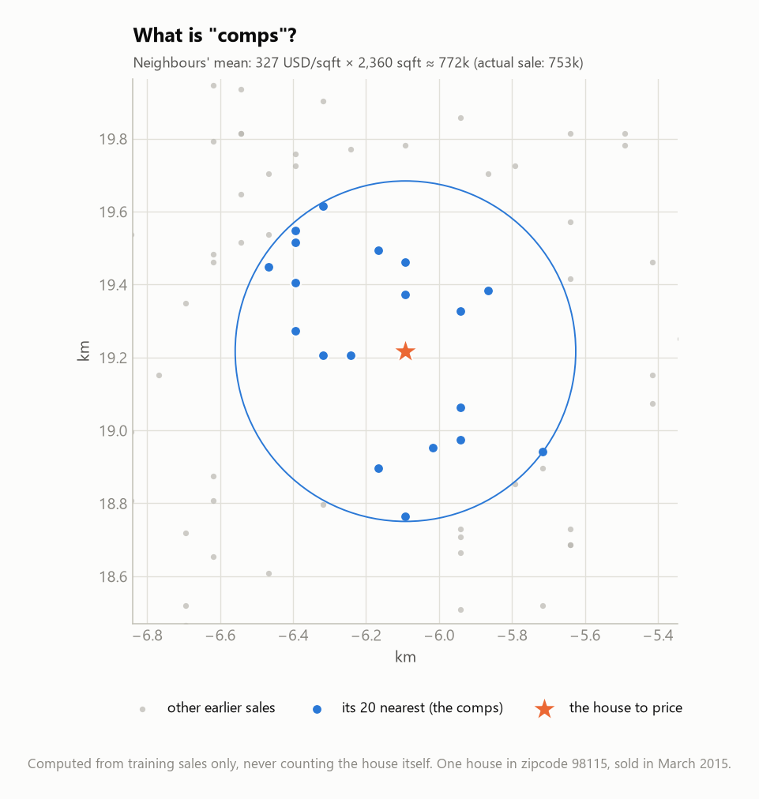

**Result**, as a paired difference on the same 5 folds (mean ± std, folds better):

| Added features | Linear: RMSE change | XGBoost: RMSE change |
|---|---|---|
| geography (distance to downtown, rotated coordinates) | −1.31k ± 0.97 (4/5) | −0.97k ± 1.60 (3/5); WAPE better in 5/5 |
| ratios (house vs. neighbours, baths per bedroom…) | −0.84k ± 1.92 (4/5) | +2.06k ± 1.68 (1/5): worse |
| comps (k = 10, 20, 50 neighbours) | **−8.96k ± 3.91 (5/5)** | +0.21k ± 3.40 (4/5): no effect |
| all of them | **−10.76k ± 3.13 (5/5)** | −0.23k ± 2.69 (3/5): no effect |

**The same feature helps one model and not the other.** Comps take the linear model from 123k to **112k**: a linear
model cannot read a map, so it needs the neighbours' prices handed to it. XGBoost already reads the map from the
coordinates, so comps add nothing. I kept geography for XGBoost (its RMSE gain is within the noise, but WAPE improved
in all 5 folds).

**So instead I fixed where XGBoost actually goes wrong:**

| Correction (learned from training data only) | What it fixes |
|---|---|
| **blend:** 80% XGBoost + 20% linear-with-comps | the two models make different mistakes |
| **neighbours' error:** if the model was too low on nearby houses, raise the price a little | whole streets priced too low |
| **market level:** add how much the model missed on the last 30 days of sales | the lag from section 7 (+2.8% by March) |

## 10. Tuning, and what each step was worth

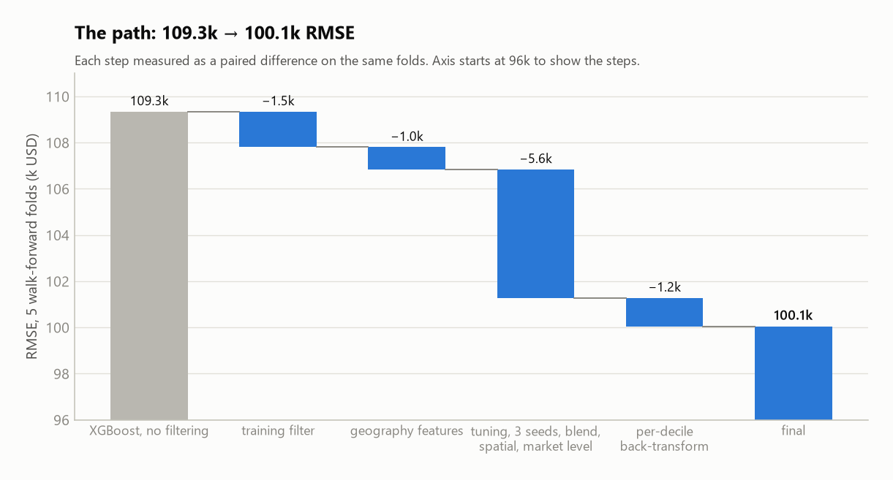

I chose all settings (XGBoost parameters and correction weights) on the first 3 folds and checked them on the last 2,
which the choice never saw:

| Last 2 folds (unseen by the choice) | WAPE | RMSE | bias |
|---|---|---|---|
| old XGBoost | 0.1192 | 110.2k | 0.957 |
| tuned XGBoost | 0.1171 | 109.2k | 0.957 |
| **final model** | **0.1117** | **104.5k** | **0.979** |

Tuning alone is worth little (−1k); the corrections are worth the most. **Seasonality:** 13 months are too few to learn
it, but even knowing each month's exact market level in advance would have helped by only 0.04 percentage points, so an
outside price index was not worth adding (appendix E).

## 11. The test set, once

The rule was written down before looking: the final model, run like real use. The model trained through March prices
April; retrained with April, it prices May. The other models go through exactly the same two steps.

| April – May 2015 (2,814 sales) | WAPE [95% interval] | RMSE [95% interval] | MAE | R² | bias |
|---|---|---|---|---|---|
| **final model** | **0.110 [0.107; 0.114]** | **106.7k [103.1; 110.0]** | **61.9k** | **0.922** | **0.982** |
| plain XGBoost | 0.130 [0.127; 0.136] | 126.2k [120.7; 133.6] | 73.4k | 0.891 | 0.924 |
| linear baseline | 0.147 [0.142; 0.155] | 148.2k [138.5; 163.0] | 82.8k | 0.850 | 0.931 |
| zipcode median (naive rule) | 0.286 [0.276; 0.298] | 315.6k [279.9; 360.4] | 161.2k | 0.321 | 0.846 |
| mean price | 0.414 [0.407; 0.422] | 383.9k [352.4; 424.2] | 233.0k | 0.00 | 0.954 |

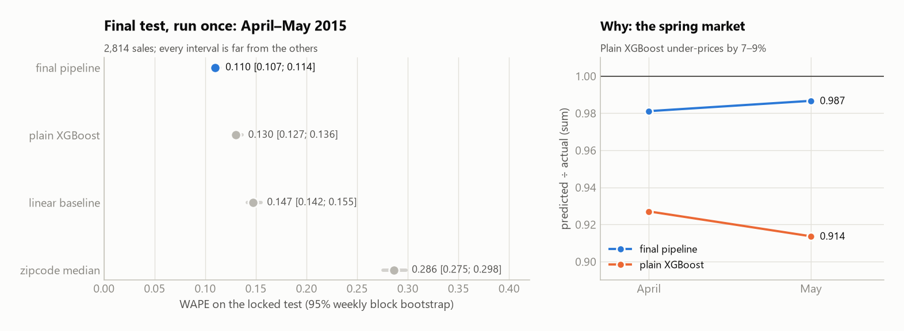

| Final model minus… | WAPE [95% interval] | RMSE [95% interval] |
|---|---|---|
| plain XGBoost | **−2.04 pp [−2.28; −1.88]** | **−19.6k [−26.8; −14.7]** |
| linear baseline | −3.70 pp [−4.16; −3.38] | −41.6k [−57.8; −32.2] |
| zipcode median | −17.6 pp [−18.8; −16.5] | −208.9k [−253.0; −173.2] |

The intervals come from a bootstrap that resamples whole **weeks** of sales (2,000 times), so sales from the same week
stay together. With only 9 weeks they are rough, but none of them touches 0.

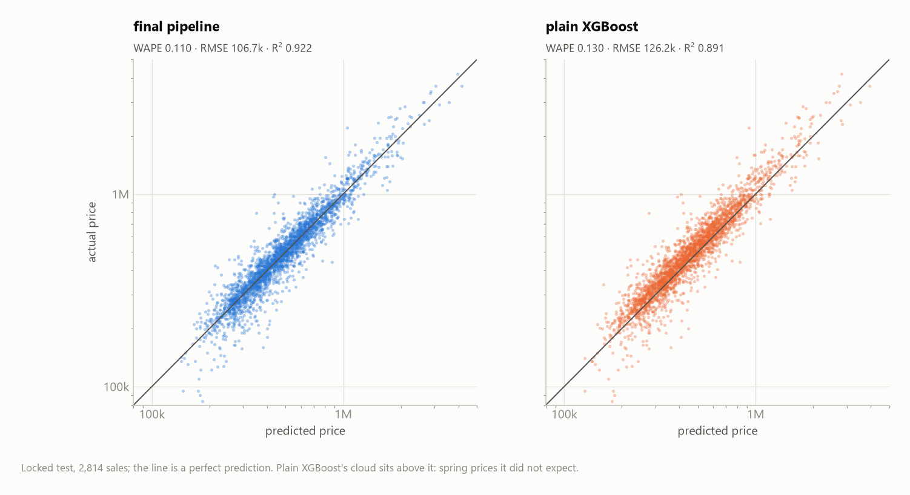

- **The test confirms the validation:** 0.109 expected, **0.110** measured.
- **The plain XGBoost fell from 0.117 to 0.130**, because it priced the spring market 7–9% too low (bias 0.924),
  exactly the lag from section 7. The final model kept its bias at 0.982: the market-level correction did its job.
- **Honesty note:** the first run crashed on a code bug (joining two tables) before showing any number. I fixed the
  bug and ran it again; nothing in the model changed.

## 12. Limitations

1. **Only 13 months of one city:** seasonality cannot be learned, and a sudden market change is noticed a month late.
2. **One description per house:** a house sold twice has the same features for two different prices, so some labels
   are noisy.
3. **No causal claims:** the model learns what similar houses sold for, not *why* (for example, why waterfront costs more).
