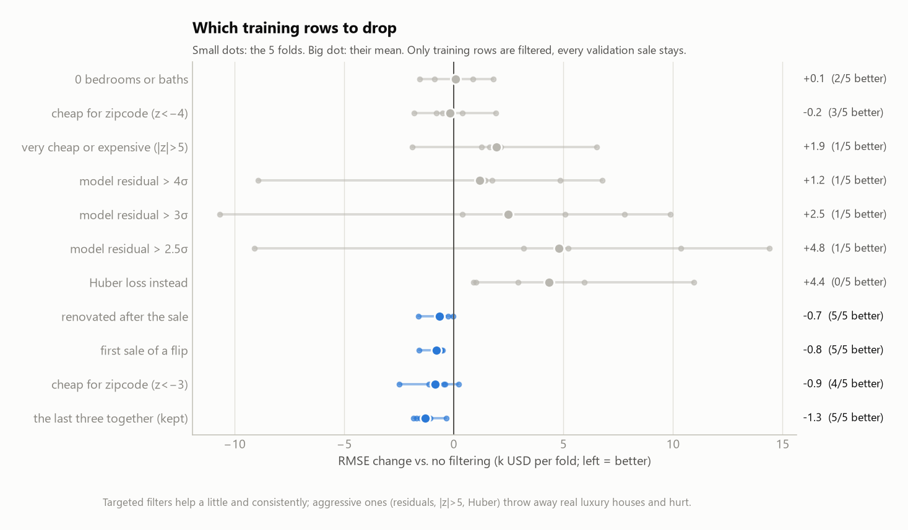
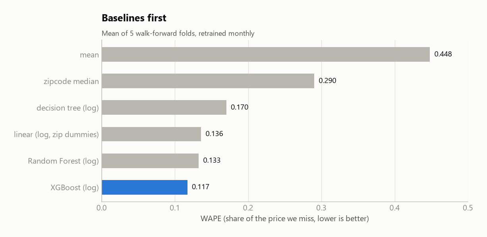
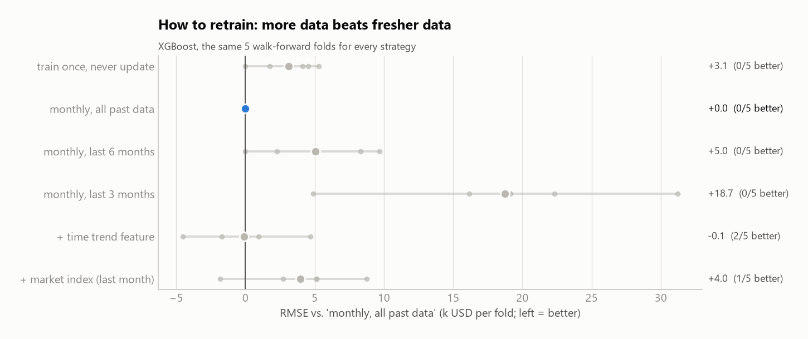
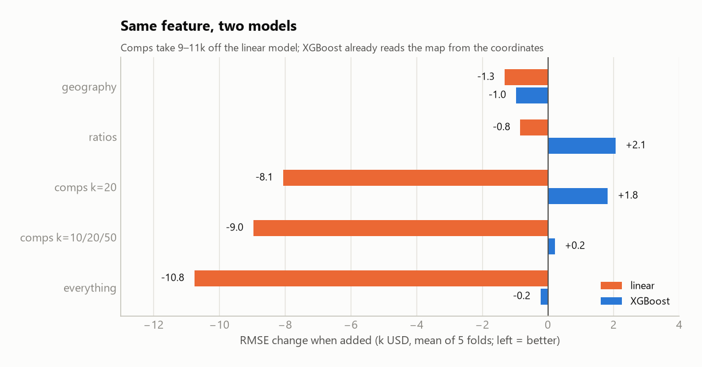
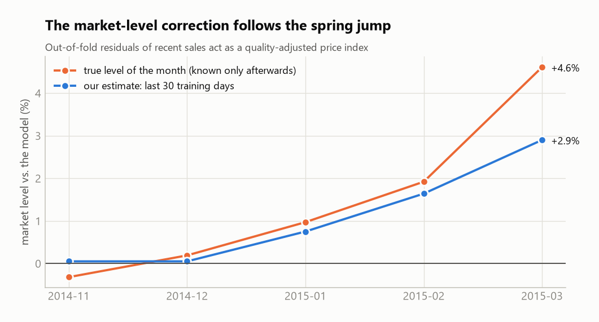
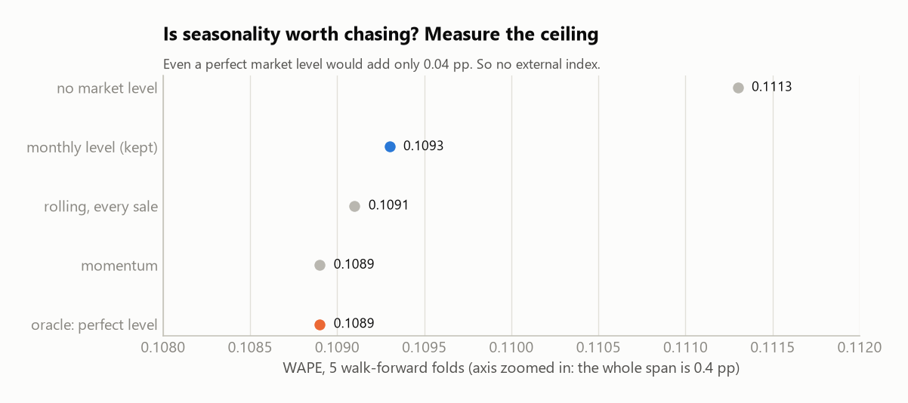

# What is this house worth next month? — Appendix

**Márton Csepregi** · Data Science workshop, lesson 5 · main write-up: [`homework.md`](homework.md)

Optional extra detail. Everything the assignment asks for is in the main write-up; this file holds the longer
explanations and every experiment that was tried and dropped.

## A. Cleaning in detail (main: section 3)

**33 bedrooms → 3.** The house has 1,620 sqft and 1.75 baths: 33 bedrooms would be 49 sqft each, while no other house
in the data goes below 163. Of 750 similar houses (1,500–1,750 sqft, 1.75 baths), **69% have 3** (19% have 4), and 8 of
11 in its zipcode have 3. So 3 is the most likely value (a doubled keystroke), not a certain one. It is not a dorm
either: at 395 USD/sqft it is priced like an ordinary house in its zipcode (median 360). Dropping the row or marking it
unknown (NaN) would have been just as defensible: the sale is from June 2014, so it is only ever a training row and
never part of any validation month or the test. The 10–11 bedroom houses are 2,900–4,600 sqft, plausible, kept.

**Checks behind the cleaning decisions:**
- **The features are one snapshot per house, not per sale.** For 184 of the 195 houses sold twice, every feature is
  identical at both sales. It also explains the oddities: 6 houses were "renovated" after they were sold and 12 were
  built after they were sold (negative age), because the record was taken later. I left these values as they are.
- **The property id is not perfect.** Coordinates are not unique (549 locations hold several different houses), so
  the id also needs size and year built. Even so, one "house" sold twice on the same day for 367,899 and 369,946:
  most likely two identical new houses in one development. 8 of the 195 "repeat" houses are new builds, and some of
  them may be such false pairs. The error is on the safe side: they are kept together, which never leaks.
- **0 bedrooms (13) or 0 bathrooms (10)** are kept: dropping them from training changed nothing (table below).
- No missing values; `sqft_living = sqft_above + sqft_basement` holds for every row.

### Every training filter I tried

Each filter was scored on the five walk-forward folds (XGBoost), as a paired difference against no filtering. Filters
touch only training rows, and anything they compute comes from the fold's training part only.

| Training filter | Rows dropped per fold | RMSE change, paired (k USD) | Folds better | Verdict |
|---|---|---|---|---|
| 0 bedrooms or 0 bathrooms | 11 | +0.07 ± 1.34 | 2/5 | no effect: the tree copes |
| very cheap for the zipcode (z < −4) | 21 | −0.16 ± 1.41 | 3/5 | noise |
| very cheap or very expensive (\|z\| > 5) | 37 | **+1.93 ± 3.01** | 1/5 | hurts: drops real luxury houses |
| model residual > 4σ / 3σ / 2.5σ | 220 / 585 / 962 | **+1.2 / +2.5 / +4.8** | 1/5 | hurts, and gets worse the more it drops |
| Huber loss instead of filtering (δ = 0.3 / 0.15) | 0 | **+4.4 / +7.2** | 0/5 | hurts in every fold |
| renovated after the sale | 6 | −0.66 ± 0.61 | 5/5 | small, consistent |
| first sale of a flip (resold at > 1.3×) | 26 | −0.80 ± 0.45 | 5/5 | small, consistent |
| very cheap for the zipcode (z < −3) | 82 | −0.85 ± 1.03 | 4/5 | small |
| **the last three together** | **~110** | **−1.30 ± 0.61** | **5/5** | **kept** |

*(z = robust z-score of log(price/sqft) within the zipcode; first round 3 seeds, the kept filters re-checked with 5.)*

- **Flips:** both sales of a flip carry the same feature snapshot, so the two prices cannot both match it. None of
  the 126 flips has a recorded renovation, and their condition is no better, so the cheap first sale may be a
  distressed sale or an unrecorded renovation. The CV, not the story, is the reason to keep this filter.
- **Renovated after the sale (6 rows):** fixing the feature ("not yet renovated at the sale") did not help
  (+0.21 ± 0.22k). Dropping the rows did.
- **Aggressive filtering backfires.** The expensive "outliers" are mostly real (zipcode 98075 alone has many), and
  a model that never sees them under-prices them in validation.
- **Honest size of the gain:** about 1.2% of RMSE. The bias (0.97) did not move under any filter: the market lag is
  not a data error.

## B. Baselines and retraining strategies (main: sections 5–7)

Paired RMSE differences against "XGBoost, retrained monthly on all past data", on the same five folds:

- **Retraining monthly pays off.** Training once and never updating is **+3.1k ± 2.2k** worse, never better in any fold,
  and the gap **grows as the model ages** (0 → 1.7 → 4.1 → 5.3 → 4.5k).
- **Throwing away old data hurts.** Only the last 6 months: **+5.0k ± 4.0k**. Only the last 3: **+18.7k ± 9.6k**.
  A softer version, **recency weights** (older sales count less, half-life 3, 6 or 12 months, 3 seeds), stays within
  the noise (best: −0.3k ± 1.2k).
- **A time trend feature does nothing for XGBoost** (−0.1k ± 3.4k): a tree cannot extrapolate past the last date it saw.
- **A raw market index makes it worse** (+4.0k ± 3.9k): the "latest month" before March is February, the seasonal
  low, so it corrects in the wrong direction.
- **Shuffled vs. walk-forward CV:** shuffled 5-fold CV reports a bias of 0.990 and a WAPE of 0.113 (walk-forward: 0.971
  and 0.117). Grouping by property changes almost nothing. RMSE levels are not comparable between the two schemes,
  because winter months sell cheaper houses: another reason for a proportional main metric.

## C. Features in detail (main: section 9)

- **Geography:** distance to downtown Seattle and Bellevue, and coordinates rotated by 15°–135° (a tree can only cut
  along axes, so a diagonal border is hard for it).
- **Ratios:** living area vs. the 15 neighbours', lot vs. neighbours, living per lot, above-ground share, baths per
  bedroom, living area per room.
- **Comps:** k = 10, 20, 50; from all training sales, from earlier sales only (exactly what production would know), or
  recency-weighted (90-day decay).

**The market-level correction** uses out-of-fold residuals from a 5-fold split inside the training part. The model has
no time feature, so its residual over the last 30 days works as a **quality-adjusted market index**: about 0 in
November, +2.0% in February, +2.8% in March. It follows the spring jump, unlike the raw index in appendix B.

## D. Tuning (main: section 10)

Tuned on folds 1–3 (2014-11 – 2015-01), checked on folds 4–5 (2015-02, 2015-03): 16 XGBoost settings (random search,
seed 42) and the correction weights.

**Chosen:** `max_depth=6, learning_rate=0.03, n_estimators=1333, subsample=0.6, colsample_bytree=0.4,
min_child_weight=3, reg_lambda=3, gamma=0.01`, averaged over 3 seeds; blend weight 0.8, neighbours' error weight 0.25,
market level over 30 days. Tuning alone is worth little (−1k RMSE); the corrections are worth the most.

| Step (all five folds) | WAPE | RMSE | bias |
|---|---|---|---|
| XGBoost, no filtering | 0.1173 | 109.3k | 0.971 |
| + training filter | 0.1164 | 107.8k | 0.974 |
| + geography | 0.1152 | 106.8k | 0.974 |
| + tuning, 3-seed bag, blend, spatial residual, market level | 0.1093 | 101.3k | 0.984 |
| + per-decile back-transform | **0.1090** | **100.1k** | **0.993** |

*(The last two lines' settings were chosen on folds 1–3, so they are slightly optimistic; the unseen-fold table in the
main text is the honest one.)*

## E. Seasonality: measuring the ceiling (main: section 10)

I considered an external index (S&P Case-Shiller Seattle, 15+ years of monthly data; the instructor allowed it), but
first measured how much a perfect market level could add at all: an *oracle* that knows each validation month's true
level (cheating, only as a ceiling).

| Market level estimate | WAPE | RMSE | bias |
|---|---|---|---|
| none | 0.1113 | 102.7k | 0.974 |
| **monthly, last 30 training days (kept)** | **0.1093** | **101.3k** | 0.984 |
| momentum (level + last month's change) | 0.1089 | 100.6k | 0.993 |
| rolling, updated at every sale, 0 / 14 / 28-day reporting lag | 0.1091 / 0.1093 / 0.1098 | 101.2k / 101.4k / 101.8k | 0.986 / 0.984 / 0.980 |
| **oracle: the month's true level** | **0.1089** | **100.9k** | **0.988** |

The monthly correction already captures almost all of the lag, so the index was not added. Even the oracle leaves a
bias of 0.988: what remains is not the market but the log back-transform, which section 8 fixes.
