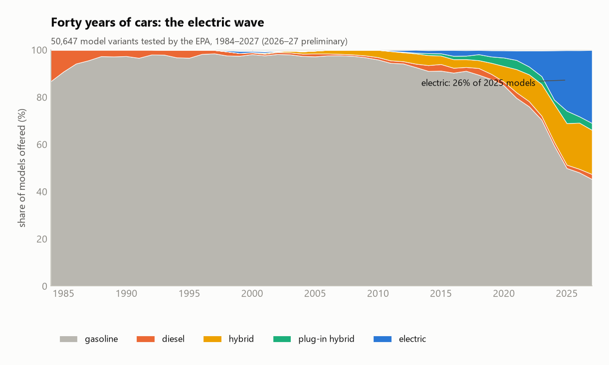
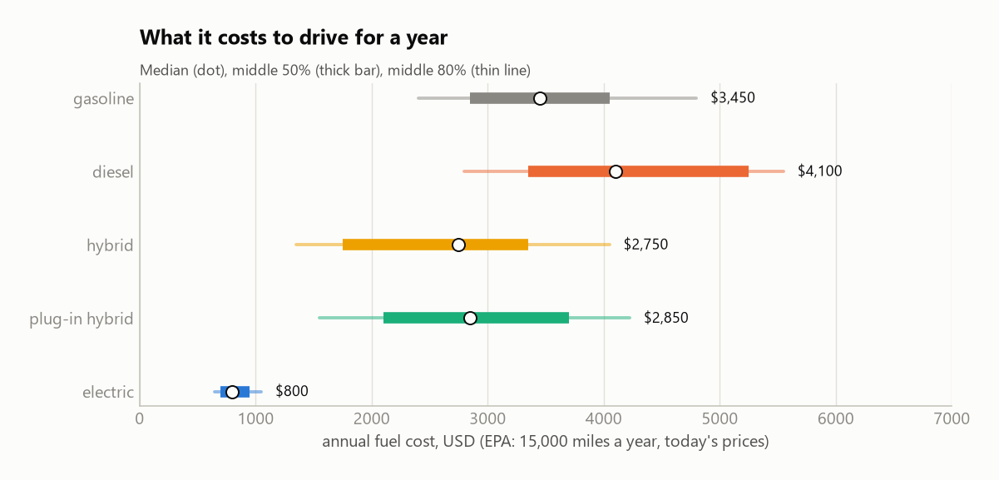
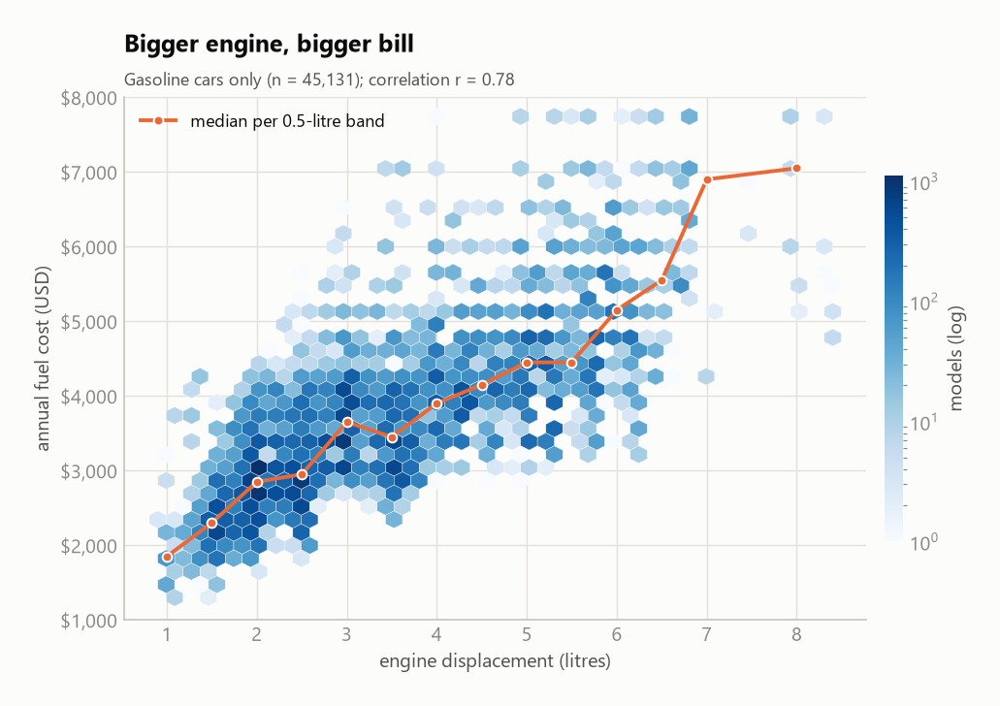
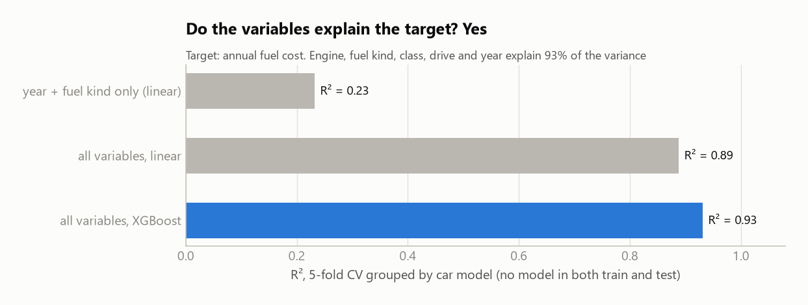

# What does a car cost to drive? — Final project: data and first look

**Márton Csepregi** · Data Science workshop · code: `epa.py`, `epa_power.py`, `epa_figures.py`

## The data

The official US fuel economy database ([fueleconomy.gov](https://www.fueleconomy.gov/feg/download.shtml),
`vehicles.csv`, public domain): **50,647 car variants** from 1984 to 2027, each measured in a lab under the same test.
84 columns: engine, transmission, drive, vehicle class, make, fuel type, consumption, CO₂, and for electric cars the
range and motor power.

**Target: annual fuel cost (USD/year)**, the EPA's estimate for 15,000 miles a year at today's fuel prices. It is in
the same unit for every car, from gasoline to electric.

| Criterion | |
|---|---|
| at least 20,000 observations | ✅ 50,647 |
| a problem I care about | ✅ cars, and the arrival of electric cars |
| the variables explain the target | ✅ R² = 0.93 (see below) |

## First look

**The electric wave:** until 2010, 95% of the models were gasoline. In 2025 only half are: **26% electric**,
18% hybrid, 5% plug-in hybrid.

**The target:** an electric car costs about **$800 a year** to drive, a gasoline car **$3,450**. Diesels look the most
expensive, but in the US diesels are mostly big pickups, so the vehicle class matters.

**The engine drives the cost:** for gasoline cars, from ~$1,800 a year with a 1-litre engine to ~$7,000 with 7 litres
(correlation 0.78).

**Do the variables explain it?** Yes: R² **0.93** with XGBoost, **0.89** with a linear model. Year and fuel kind alone
give only 0.23. The cross-validation is grouped by car model, so the same model never appears in both training and
test.

## To watch out for

- **Near-duplicates** (4,981 rows: same model, year, engine, transmission): always split by car model.
- **Electric cars have no engine size or cylinders:** a separate "electric" flag, motor power (kW) from text.
- **Fuel cost uses today's prices**, so it compares the cars' technology, not what owners paid back then.
