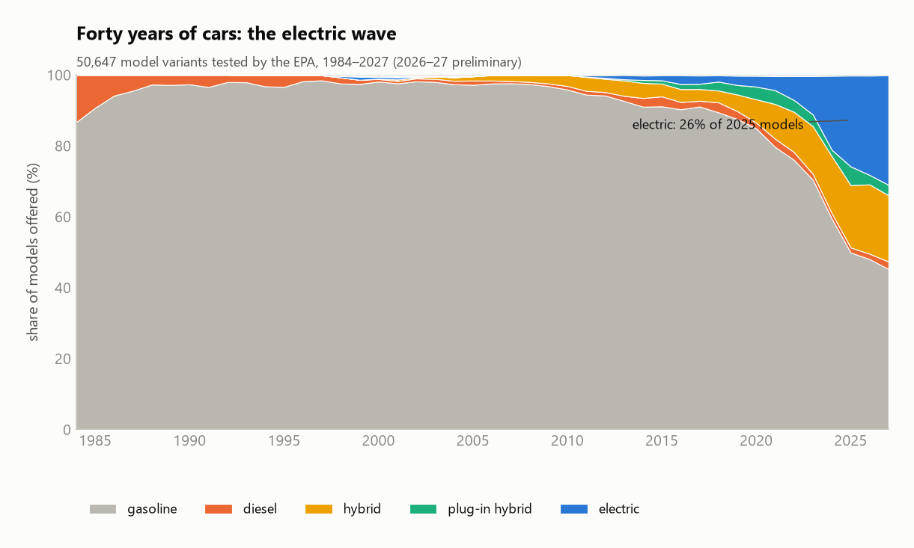
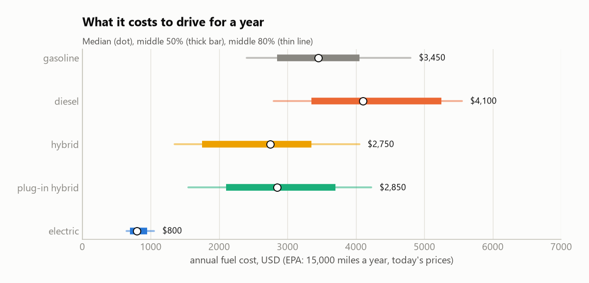
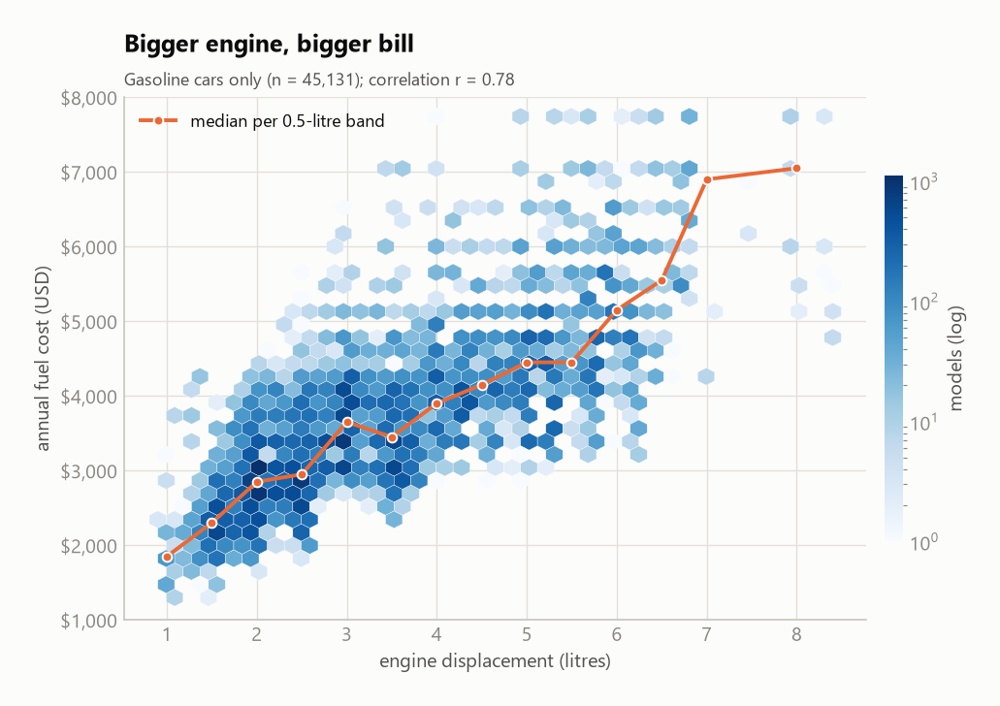
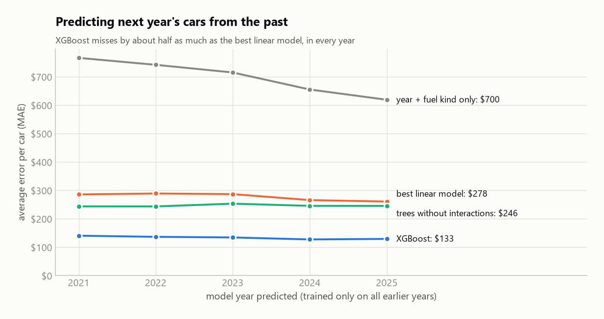

# What does a car cost to drive? — Final project: data and first look

**Márton Csepregi** · Data Science workshop · code: `epa.py`, `epa_time.py`, `epa_figures.py`

## The data

The official US fuel economy database ([fueleconomy.gov](https://www.fueleconomy.gov/feg/download.shtml),
`vehicles.csv`, public domain): **50,647 car variants** from 1984 to 2027, each measured in a lab under the same test.
84 columns: engine, transmission, drive, vehicle class, make, fuel type, consumption, CO₂, and for electric cars the
range and motor power.

**Target: annual fuel cost (USD/year)**, the EPA's estimate for 15,000 miles a year at today's fuel prices. It is in
the same unit for every car, from gasoline to electric.

| Criterion | |
|---|---|
| at least 20,000 observations | ✅ 50,647 |
| a problem I care about | ✅ cars, and the arrival of electric cars |
| the variables explain the target | ✅ R² = 0.97 when predicting new model years from older ones (see below) |

## First look

**The electric wave:** until 2010, 95% of the models were gasoline. In 2025 only half are: **26% electric**,
18% hybrid, 5% plug-in hybrid.

**The target:** an electric car costs about **$800 a year** to drive, a gasoline car **$3,450**. Diesels look the most
expensive, but in the US diesels are mostly big pickups, so the vehicle class matters.

**The engine drives the cost:** for gasoline cars, from ~$1,800 a year with a 1-litre engine to ~$7,000 with 7 litres
(correlation 0.78).

## Predicting the future from the past

*Feedback I got: (1) predict the future from the past, (2) a non-linear model may add little, since the problem looks
linear. So I tested both.*

**The split is now by time.** Each model learns only from older model years and predicts the next one: trained on
1984–2020 it predicts 2021, then on 1984–2021 it predicts 2022, and so on until 2025 (the 2026–27 data is preliminary,
so it is left out). This is how the model would really be used: to price the cars of a new model year.

| Predicting 2021–2025, one year at a time | R² | average error per car | bias |
|---|---|---|---|
| year + fuel kind only | 0.42 | $700 | 0.98 |
| best linear model (log cost, separate for electric cars) | 0.90 | $278 | 0.96 |
| trees **without** interactions (XGBoost, depth 1) | 0.92 | $246 | – |
| **XGBoost** | **0.97** | **$133** | **1.00** |

**Is the problem linear? Mostly, but not enough.** A linear model already explains 90% of the variance. But XGBoost
misses by **half as much ($133 vs. $278), in all 5 years** (−$144 ± $9), and the linear model prices 4% too low. I
gave the linear model a fair chance (log cost, a separate model for electric cars), and it barely moved.

**Where the difference comes from:** trees that may only bend one variable at a time (no interactions) get to $246.
The rest of the gain, $246 → $133, comes from **interactions**: the same engine costs differently in a pickup and in a
small car, or with and without a turbo. A plain linear model cannot see that.

**Plan:** XGBoost as the main model, the linear model as an interpretable baseline (how many dollars a litre of engine
or an electric drive is worth), and interactions as a possible way to make the linear model competitive.

## To watch out for

- **Split by time, not at random:** the real question is pricing *next year's* cars.
- **Near-duplicates** (4,981 rows: same model, year, engine, transmission): in a time split this is fine (when a new
  model year comes out, its earlier versions are known), but a random row split would put near-copies of the same car
  in both training and test.
- **Electric cars have no engine size or cylinders:** a separate "electric" flag, motor power (kW) from text.
- **Fuel cost uses today's prices**, so it compares the cars' technology, not what owners paid back then.
